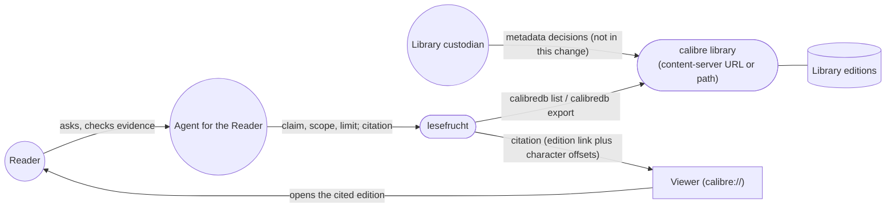
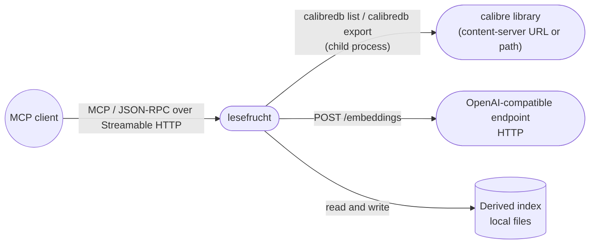

# 3. Context and Scope

## Business context

The product sits between a private calibre library and the agent that answers
for the reader. It reads the library, derives an index, and serves evidence.

| Partner / User | Input to system | Output from system |
|---|---|---|
| Agent for the Reader | A claim or phrase in one language, an optional scope (genre, language, authors, year range, works), a requested number of passages, and later a citation to widen | Up to the requested number of candidate passages (at most 20) with citation, score and expansion used; surrounding text with exact bounds; `no evidence` with its reason; an unavailability report |
| Reader | Nothing directly in this change — the reader is served through the agent | Via the agent: citations the reader can open in the viewer |
| calibre library (`calibredb`) | Catalogue listing and edition files | `list` and `export` requests against a content-server URL or a local library path |
| OpenAI-compatible endpoint | Embeddings for passage text and for the search claim | Passage texts, batched |
| Viewer (`calibre://`) | A citation | The edition that holds the cited passage; the exact position is the character span the citation carries, which the reader navigates to |

## Technical context

| Interface | Technology / Protocol | Direction |
|---|---|---|
| Agent surface | MCP (JSON-RPC 2.0) over Streamable HTTP, single endpoint path | in |
| Library catalogue and edition files | `calibredb` child process (`list`, `export`) against a content-server URL or a library path | out |
| Embeddings | HTTP POST `/embeddings`, OpenAI-compatible JSON | out |
| Citation opening | `calibre://show-book/<library>/<work>` opens the edition; the exact position is the character span in the citation payload | out (to the reader's viewer) |
| Index | Local derived files, rebuildable from the library | internal persistence |

Scope of this change: the two agent actions of `find-passages` and the indexing
subfunction that makes them possible. Outside the boundary: composing answers,
ranking works, comparing or summarizing works, classification and metadata
review, the glossary's changing cases, the web surface and any reader-facing
CLI.
