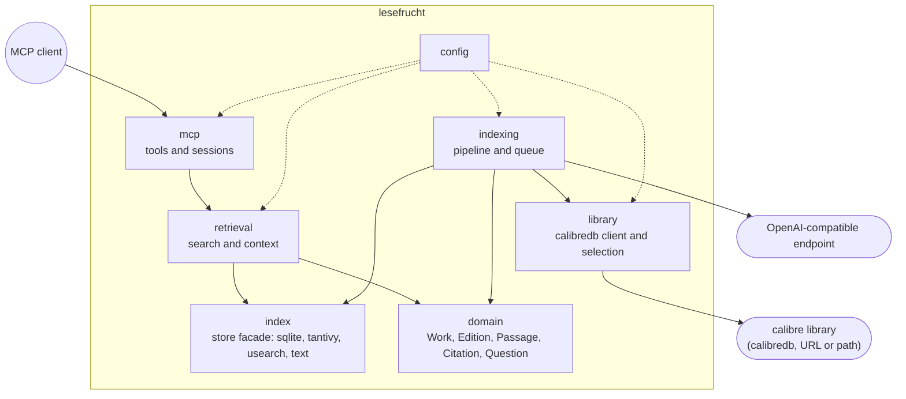

# 5. Building Block View

## Level 1 — System overview

| Building block | Responsibility |
|---|---|
| `domain` | The vocabulary and result shapes: `Work`, `Edition`, `Passage`, `Citation`, `Genre`, `Question`, the exactly-one `QuestionOutcome`, ids. Depends on nothing. |
| `mcp` | The agent surface: session handling, the two tools, request validation, the tagged result serialisation, protocol errors. |
| `retrieval` | Expansion, scope resolution, both retrieval paths, evidence threshold, fusion, ordering, cap and `short`; plus context widening for a citation. |
| `indexing` | The enabling subfunction: discovery, edition selection, extraction, chapter-aware chunking, embedding, index state machine and the single-consumer queue. |
| `library` | The `calibredb` client (list, export, per-run temp directories), the listing parser and the selection policy (format preference, one selected edition per work). There is no HTTP calibre client and no calibre twin. |
| `index` | The store facade: SQLite metadata and state, the Tantivy directory, the usearch file, the normalized text files, and the repair pass. |
| `config` | TOML plus environment, validation, and the required-endpoint rule. |

Dependency direction: `mcp` → `retrieval` → `index`/`library` → `domain`;
`indexing` → `index`/`library`/`domain`. `domain` depends on no other block.
Only `index::store` writes to the derived stores.

## Level 2 — Key building blocks

### `retrieval`

**Responsibility:** turn a `Question` into exactly one outcome, and a citation
into its surrounding text.

**Contained elements:**

| Element | Responsibility |
|---|---|
| `expand` | Normalize the claim, look up accepted glossary terms, load the configured synonym map, produce ordered de-duplicated expansion terms. |
| `scope` | Resolve genre, language, authors, year range and work ids against the work table; the strict unknown-work rule lives here. |
| `lexical` | Build the Tantivy query over claim and expanded terms, apply the scope filter inside the query, return ranked candidates. |
| `vector` | Embed the expanded query, search usearch with scope overfetch, apply the scope predicate, return ranked candidates. |
| `fuse` | Apply the evidence threshold per path, run RRF, sort by `(score desc, work id numeric asc, passage index asc)`. |
| `service` | Freshness gate, limit clamp and `short`, outcome selection, orchestration of the paths. |
| `context` | Widen a cited passage within its chapter, clamp to the configured window, verify the cited span's hash. |

### `library`

**Responsibility:** turn the calibre library into a listing of works and
editions, and produce edition bytes on demand, through the documented CLI only.

**Contained elements:**

| Element | Responsibility |
|---|---|
| `calibredb` | Spawn `calibredb list`/`calibredb export` with `--with-library`, enforce the per-invocation timeout, parse one JSON array of per-book objects, create and remove the per-run temp directory. |
| `discovery` | Map the listing (`id`, `title`, `authors`, `languages`, `tags`, `pubdate`, `formats`) to `Work` and candidate `Edition` records. |
| `selection` | Apply `edition.format_preference`; exactly one selected edition per work. |

### `indexing`

**Responsibility:** keep exactly one recorded index state per edition and make
the derived index match the library.

**Contained elements:**

| Element | Responsibility |
|---|---|
| `queue` | Single-consumer queue; serialises indexing work; one requester of the format-selection policy at a time. |
| `extract` | Per-format extractors returning ordered chapters; the unsupported-format path fails with a reason before downloading. |
| `chunk` | Chapter-bounded splitting with overlap and deterministic character offsets. |
| `embed` | Batch requests, dimension validation, typed failure. |
| `state` | The edition state machine, `library_generation`, freshness evaluation, `/healthz` status projection. |
| `pipeline` | Content-hash skip, write ordering, commit, repair on startup. |

### `index`

**Responsibility:** be the only writer of the derived stores and the only
reader the retrieval paths use.

**Contained elements:**

| Element | Responsibility |
|---|---|
| `store` | `commit_edition`, `repair`, reads by citation, generation and state accessors. |
| `sqlite` | Schema, migrations, work and passage queries, transactions. |
| `lexical_index` | Tantivy schema, writer commits, reader reload. |
| `vector_index` | usearch key mapping, persistence, compaction on delete. |
| `text_store` | Normalized edition text keyed by content hash; the offset basis. |
