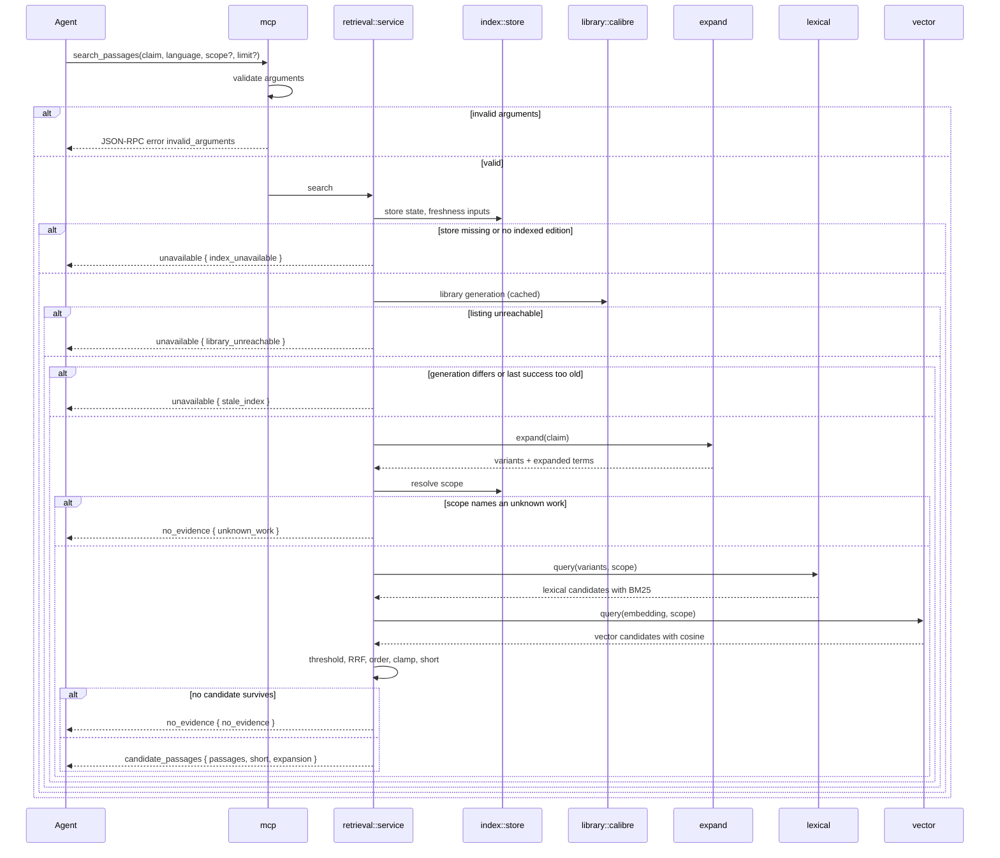
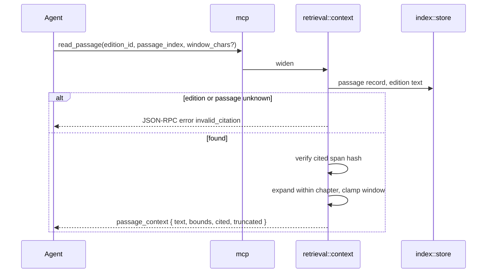
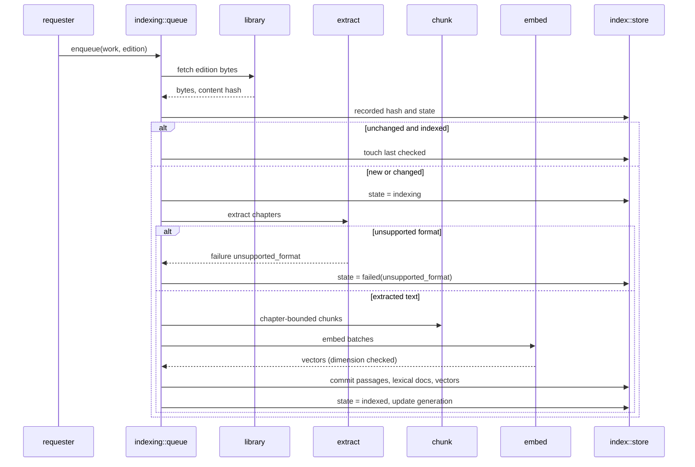

# 6. Runtime View

## Scenario: `search_passages` — candidate passages, abstention, unavailability

**Trigger:** an agent calls `search_passages` with a claim, a language, an
optional scope and an optional limit.

**Steps:**

1. The tool validates the request shape; a malformed request is a protocol
   error, never a tagged result.
2. The service reads the store state and the freshness inputs.
3. Unavailability is decided before any retrieval, so it cannot be reported as
   `no evidence`.
4. Expansion and scope resolution run in that order; an unknown work id in the
   scope stops the flow before either retrieval path runs.
5. Both paths run with the scope already applied; the threshold keeps only
   candidates that clear it on at least one path.
6. Fusion, ordering, clamping and the `short` flag produce the result.

**Notes:** the freshness generation read is cached for a configured interval to
avoid a content-server call per request. The result is deterministic for a fixed
index, configuration and library generation; scores are floats and are not part
of the contract's stability.

## Scenario: `read_passage` — widening a citation

**Trigger:** an agent calls `read_passage` with an edition id, a passage index
and an optional window.

**Steps:**

1. The passage record supplies the cited span, its chapter and its text hash.
2. The cited span is sliced from the stored normalized text and its hash is
   compared with the record; a mismatch is a failure, not a silent answer.
3. The window is expanded by `window_chars` on both sides and clamped to the
   chapter bounds; `truncated` reports a clamp.
4. The response carries the returned text bounds and the cited bounds
   separately, both as Unicode scalar indices.

**Notes:** widening never crosses a chapter boundary, so the returned text
always belongs to one chapter and one citation.

## Scenario: index an edition

**Trigger:** startup, or a library change discovered by the requester.

**Steps:**

1. The content hash decides whether work is needed at all; an unchanged hash is
   never re-extracted and never re-embedded.
2. Failure is recorded with its reason, so `/healthz` and the agent can
   distinguish a missing capability from a missing passage.
3. The commit writes passages and state transactionally, then the lexical
   commit, then the vector save; the edition becomes `indexed` only after all
   three succeed.
4. On startup a repair pass marks editions whose passage count disagrees with
   the lexical or vector store as `invalidated`, and the queue re-indexes them.

**Notes:** the queue has one consumer, so indexing never competes with itself,
and the store facade serialises writes against concurrent retrieval reads.

## Scenario: start and readiness

**Trigger:** the process starts.

1. Configuration is loaded and validated; a missing library or embedding
   endpoint stops startup with a named error.
2. The store is opened and the repair pass runs.
3. The MCP endpoint and `/healthz` are mounted on the bind address.
4. `/healthz` reports `indexed_editions`, `failed_editions`, `last_success_at`,
   `library_generation` and the store state. It never returns book text.

**Notes:** readiness for tests means HTTP 200 on `/healthz`; index readiness
means at least one indexed edition with `index_state = ready`, which the e2e
`Given` polls. The product never blocks a retrieval until indexing finishes.
