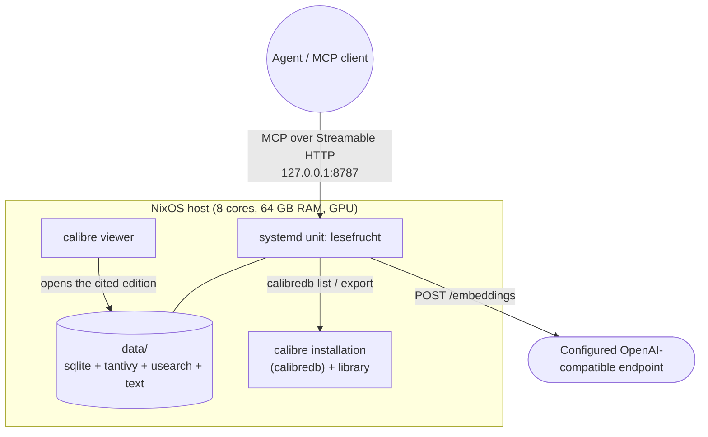
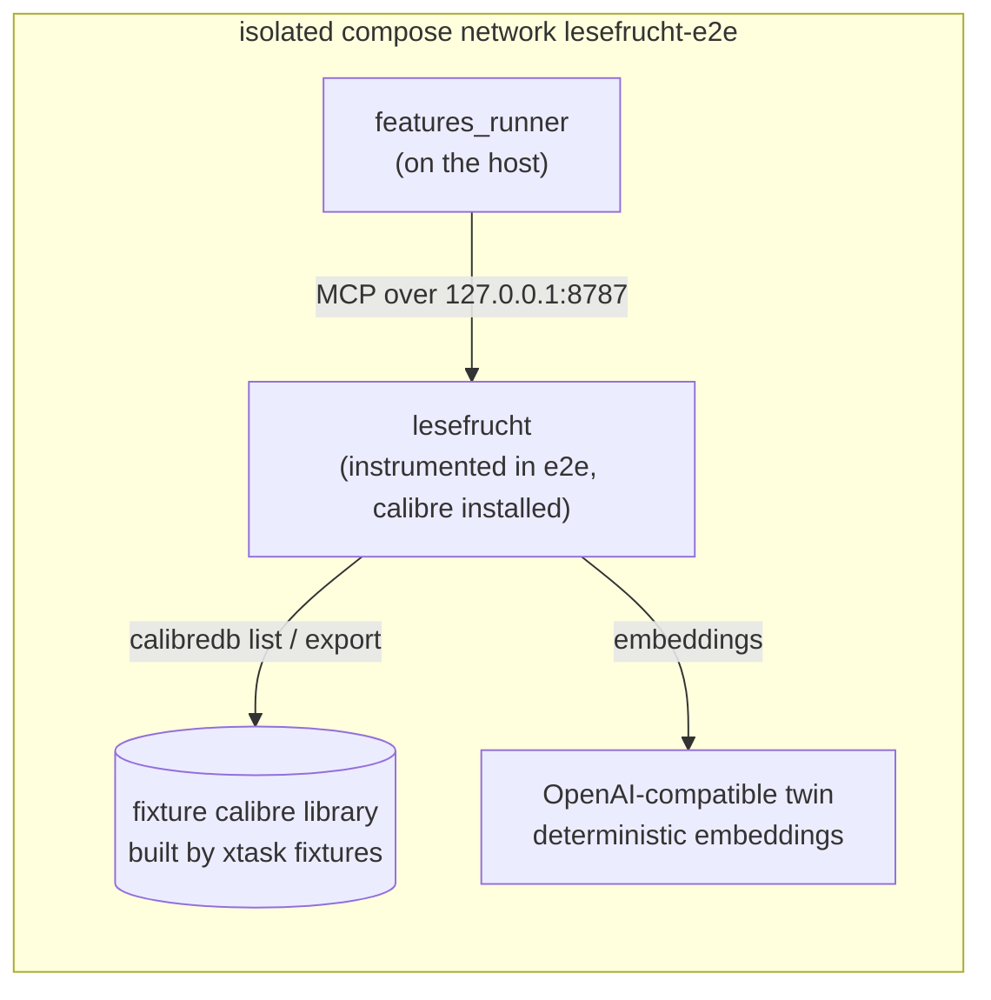

# 7. Deployment View

## Infrastructure level 1

| Node / Environment | Description |
|---|---|
| NixOS host | Production and development machine of the single owner. The service runs as a systemd unit, not in a container. |
| `data/` directory | The derived index: SQLite database, Tantivy directory, usearch file, normalized text. Rebuildable from the library; not a backup target. |
| calibre installation and library | The `calibre` package provides `calibredb` on the host; `library.url` names the content-server URL or the local library path that every invocation passes as `--with-library`. The desktop application may run in parallel. |
| Configured embedding endpoint | Any OpenAI-compatible service the owner configures; there is no default. |
| Agent | Any MCP client the reader points at the endpoint. |

## Infrastructure level 2

### `lesefrucht` (production)

| Property | Value |
|---|---|
| Hardware / VM | Shared NixOS host, 8 cores, 64 GB RAM, GPU (unused by this change) |
| OS | NixOS, Linux |
| Middleware / Runtime | Rust binary under systemd; no container runtime required. The systemd unit must have the calibre package on `PATH` (or `library.calibredb_binary` set to its absolute path) and a writable `TMPDIR` for the per-run export directory |
| Key software deployed | `lesefrucht` server, the `calibre` package (for `calibredb`), configuration at a path given on the command line, data directory on local disk |
| Network exposure | Loopback by default; the bind address is configuration |
| Readiness | `/healthz` returns 200 when the MCP endpoint is mounted and the store is open |

### Test and local stack

There is no content-server twin. The product image installs calibre from the
same pinned nixpkgs revision as the development shell, and the fixture calibre
library is baked at image build time by `xtask fixtures`, which adds the fixture
sources with `calibredb add` at fixed mtimes. The runner runs on the host and
reaches the product through a loopback-published port; the product reaches the
embedding twin by service name inside the network and reads the library from its
own filesystem. Only the two loopback ports are published, no dependency is
shared with another project, and no live third-party service participates.
Teardown removes the network and its volumes (`podman-compose down -v`).
