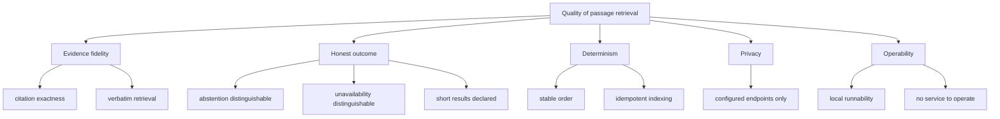

# 10. Quality Requirements

## Quality tree

## Quality scenarios

| ID | Quality attribute | Scenario | Metric / Acceptance criterion |
|---|---|---|---|
| QS-001 | Evidence fidelity | An agent widens the context around a cited passage. | The cited span's sha256 equals the stored passage hash, and the returned text contains the cited text verbatim at the reported offsets. |
| QS-002 | Determinism | The same claim, scope and limit are submitted twice against an unchanged index and library generation (`Identical requests return the same sequence`). | Identical citations in identical order in both candidate-passage results. |
| QS-003 | Honest outcome | The claim matches nothing above the evidence threshold. | The response is `no_evidence` with reason `no_evidence`; it is neither a JSON-RPC error nor a successful result with an empty passage list. |
| QS-004 | Honest outcome | Fewer passages than requested exist above the threshold. | `requested` is the clamped effective limit, `returned` equals the number above the threshold, and `short = (returned < requested)` with no padding. For `limit: 50` the report is `requested: 20`; with twenty candidates `short` is `false`, with four it is `true`. |
| QS-005 | Honest outcome | The index is older than the freshness bound, or the library generation differs (`A stale index yields an unavailability report`); separately, no edition is indexed or the store is unavailable (`An unavailable index yields an unavailability report`). | The response is `unavailable` with reason `stale_index` or `index_unavailable` respectively, distinguishable from `no_evidence` by the `kind` field. |
| QS-006 | Evidence fidelity | A scope names a work the library does not hold. | The response is `no_evidence` with reason `unknown_work` and contains no passage from any other work. |
| QS-007 | Non-mutation | An agent retrieves passages and widens one (`A retrieval never changes the library`); the library listing, the accepted glossary and the index state are compared before and after. | The `calibredb list` output, the accepted glossary, the index generation and `last_success_at` (read through the readiness probe) are identical; only `calibredb list` and `calibredb export` were invoked, no write command. |
| QS-008 | Determinism | An edition is indexed twice without a content change. | Identical passage ids, offsets and texts; no embedding request is made on the second pass. |
| QS-009 | Operability | A developer runs the local stack from a clean checkout. | One command brings up the product, the embedding twin and the fixture calibre library; no live third-party service and no network beyond the isolated network is used. |
| QS-010 | Performance | A request runs against a library of a few thousand books. | The retrieval itself (excluding index bootstrap) completes within a few seconds on the owner's host; the embedding endpoint is the only variable cost, and the `calibredb list` generation read is cached. |
| QS-011 | Privacy | Any retrieval runs with only the configured endpoints present. | No outbound request exists to any host other than the library target (`library.url`) and `embedding.base_url`; logs contain no book text. |
| QS-012 | Honest outcome | A claim is scoped to a work whose only edition is a format the product cannot read (`An abstention names the editions that failed indexing`). | The response is `no_evidence` with reason `no_evidence` and an `indexing.failed` entry carrying the work id, edition id, format and reason `unsupported_format`; the agent can distinguish a missing passage from a missing capability without a third tool. |

Supporting notes:

- QS-001, QS-002, QS-003, QS-004, QS-005, QS-006, QS-007 and QS-012 are the
  assertions of the delta's scenarios; the measurable statements above are what
  their steps assert.
- QS-008 is a design-invariant test (indexing the fixture library twice) rather
  than a consumer-observable scenario; it is named here so the idempotence target
  is measurable.
- QS-010 is an operating envelope, not a measured benchmark: no latency budget
  belongs to this change. It is recorded so a later change that would break it
  has a reference.
- QS-011 is verified by construction (the library target and the embedding
  endpoint are required, with no default) plus the e2e network isolation.
