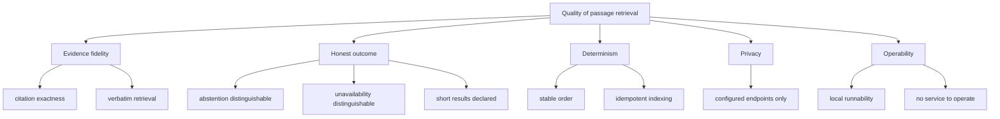

# 10. Quality Requirements

## Quality tree

## Quality scenarios

| ID | Quality attribute | Scenario | Metric / Acceptance criterion |
|---|---|---|---|
| QS-001 | Evidence fidelity | An agent widens the context around a cited passage. | The cited span's sha256 equals the stored passage hash, and the returned text contains the cited text verbatim at the reported offsets. |
| QS-002 | Determinism | The same claim, scope and limit are submitted twice against an unchanged index and library generation. | Identical passage ids in identical order, on both submissions. |
| QS-003 | Honest outcome | The claim matches nothing above the evidence threshold. | The response is `no_evidence` with reason `no_evidence`; it is neither a JSON-RPC error nor a successful result with an empty passage list. |
| QS-004 | Honest outcome | Fewer passages than requested exist above the threshold. | `returned < requested`, `short = true`, and the passage count equals the number above the threshold (no padding). |
| QS-005 | Honest outcome | The index is older than the freshness bound, or the library generation differs. | The response is `unavailable` with reason `stale_index`, distinguishable from `no_evidence` by the `kind` field. |
| QS-006 | Evidence fidelity | A scope names a work the library does not hold. | The response is `no_evidence` with reason `unknown_work` and contains no passage from any other work. |
| QS-007 | Non-mutation | An agent retrieves passages and widens one; the library metadata and index state are compared before and after. | Catalogue listing and index generation are byte-identical; no write request reaches the content server. |
| QS-008 | Determinism | An edition is indexed twice without a content change. | Identical passage ids, offsets and texts; no embedding request is made on the second pass. |
| QS-009 | Operability | A developer runs the local stack from a clean checkout. | One command brings up the product and both twins; no live third-party service and no network beyond the isolated network is used. |
| QS-010 | Performance | A request runs against a library of a few thousand books. | The retrieval itself (excluding index bootstrap) completes within a few seconds on the owner's host; the embedding endpoint is the only variable cost. |
| QS-011 | Privacy | Any retrieval runs with only the configured endpoints present. | No outbound request exists to any host other than `library.base_url` and `embedding.base_url`; logs contain no book text. |

Supporting notes:

- QS-001, QS-002, QS-003, QS-004 and QS-005 are the assertions of the delta's
  scenarios; the measurable statements above are what their steps assert.
- QS-010 is an operating envelope, not a measured benchmark: no latency budget
  belongs to this change. It is recorded so a later change that would break it
  has a reference.
- QS-011 is verified by construction (both endpoints required, no default) plus
  the e2e network isolation.
