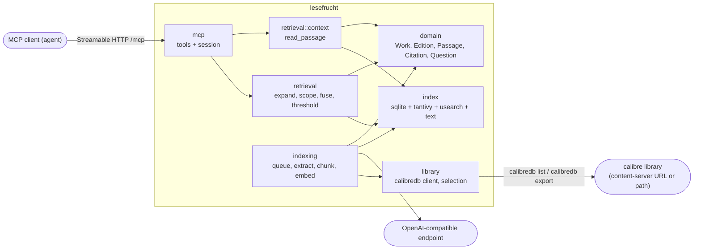
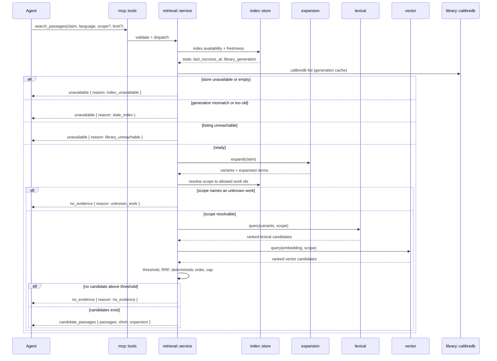
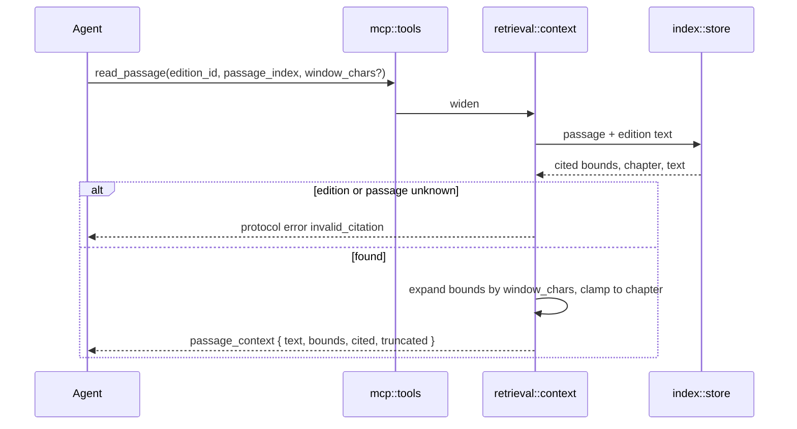
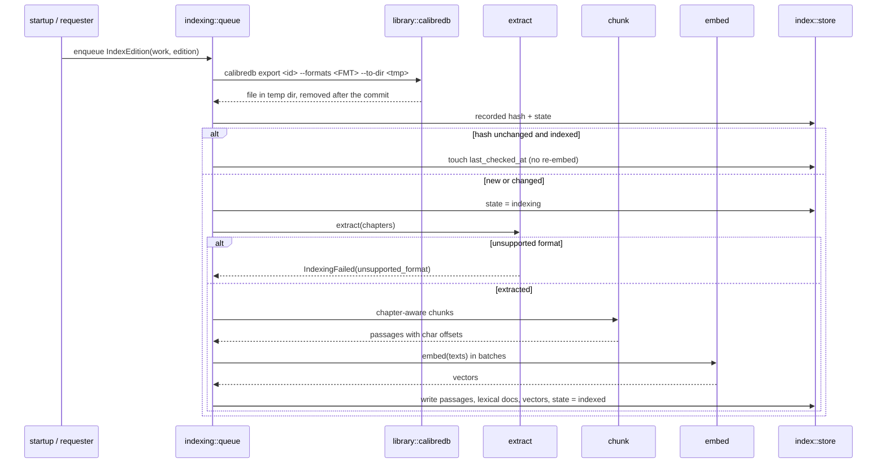

# Design: passage-retrieval

Change: `passage-retrieval` — use case `find-passages`, capability
`passage-retrieval` (`NEW in find-passages`).

The design implements the delta
`givn/changes/passage-retrieval/specs/find-passages/passage-retrieval.feature`
and the permanent contract `givn/specs/find-passages/usecase.md`. It does not
change the WHAT: the proposal and the feature are authoritative.

The product is greenfield. This change creates the first workspace, its
indexing subfunction, the retrieval pipeline, and the agent-facing MCP surface.
Everything below is a decision for the implementer, not a restatement of the
scenarios.

## Technology Decisions

### Stack

| Concern | Decision | Resolution / why |
|---|---|---|
| Language | Rust, edition 2024 | Given constraint of the topic (`frame.md`). One language for product, twins and fixtures keeps the fixture generators and the deterministic embedding twin in the same toolchain. |
| Toolchain | Rust stable, pinned by exactly one mechanism: the Nix flake devShell (`nix develop`), which provides `nixpkgs#rustc`, `nixpkgs#cargo` and `nixpkgs#calibre` | The host's rustup cannot be the pin: `rustup show` reports default host `x86_64-unknown-linux-musl`, no installed toolchain and no default (observed 2026-10-27), so `rustc` and `cargo` fail with "could not choose a version". There is no `rust-toolchain.toml`; the devShell is the single pin and the setup task records the versions it resolves. |
| Async runtime | `tokio` 1.x | The HTTP server, the MCP transport, the `calibredb` child-process supervision and the embedding client are all I/O-bound; one runtime avoids a second concurrency model. |
| HTTP server | `axum` 0.8.x | Mounts the MCP Streamable HTTP endpoint and `/healthz` on one listener and shares the same `tower` stack rmcp's server transport expects. |
| MCP SDK | `rmcp` 3.8.x, features `server`, `transport-streamable-http-server`; the e2e client uses `client`, `transport-streamable-http-client-reqwest` | Official Rust SDK for the protocol. Hand-rolling JSON-RPC would re-implement session ids, capability negotiation and SSE framing that the SDK already tracks; the SDK also gives the e2e driver a real protocol client. |
| MCP transport | Streamable HTTP on `/mcp` | See ADR-0002. stdio would tie one process to one client and cannot serve the forward-looking second surface; plain SSE is the legacy transport. |
| Index store | Embedded: `tantivy` 0.27 for the lexical index, `usearch` 2.26 for the vector index, `rusqlite` 0.41 (SQLite, WAL) for metadata, index state and passage records | See ADR-0001. No external service: the frame forbids a mandatory container, and the index must be rebuildable from the library. |
| Lexical path | `tantivy` BM25 over a passage schema, `rust-stemmers` (German, English) | BM25 gives a calibrated, per-language score for the evidence threshold, which SQLite FTS5 cannot express per language. |
| Vector path | `usearch` HNSW, cosine metric, `dimension` from config | Single-file, memory-mapped, no Arrow/Lance dependency; a few million passages fit comfortably. |
| Embeddings | Any OpenAI-compatible `POST {base_url}/embeddings`, `reqwest` 0.13 client | Model access is "OpenAI-compatible endpoints" (given). `base_url` and `model` are required configuration with no default — the rights-holder boundary. |
| Query expansion | Deterministic only in this slice: accepted glossary terms (glossary table exists, zero rows) + a configured synonym file | The expansion must be reproducible for a deterministic result order and for a meaningful `expansion used` field. Model-based expansion is deferred; the endpoint is already present for embeddings, so adding it later is a configuration change. |
| EPUB extraction | `rbook` 0.7 (EPUB 2/3, chapter list from the spine/TOC) | Needs chapter boundaries, which raw zip + HTML parsing would have to rebuild. |
| PDF extraction | `pdf-extract` 0.12 | Text plus page breaks; a PDF without a usable outline is one chapter (see Indexing Subfunction). |
| AZW3 / MOBI extraction | **Not supported in this change** — recorded as `IndexingFailed { reason: unsupported_format }` | A second parser plus a MOBI fixture writer would not add observable behaviour to this slice; the failure is explicit, never a silent skip. The extractor to adopt later is `rbook`'s reader, which already handles these formats. |
| Chunking | `text-splitter` 0.33, character capacity, sentence-aware | Passage identity must be deterministic across re-indexing; a tokenizer-dependent split would change offsets when a tokenizer updates. |
| Config | TOML file + `LESEFRUCHT__<SECTION>__<KEY>` environment overrides, `serde` | Tests set thresholds and freshness via environment without rewriting the file. |
| Errors | `thiserror` 2.0 for typed errors, `anyhow` 1.0 in `main` | Typed result taxonomy is part of the MCP contract; `anyhow` is confined to process startup. |
| IDs | `uuid` 1.29 for internal request ids, calibre book id as `WorkId` | The work identity is calibre's; ids the product invents must not compete with it. |
| Library interface | The `calibredb` CLI as a child process: `calibredb list --with-library <url-or-path> --for-machine --fields all` for discovery, `calibredb export --with-library <url-or-path> --to-dir <tmp> --single-dir --formats <FMT> --dont-save-cover --dont-write-opf <id>` for edition bytes | This is the documented calibre interface and it works against a content-server URL as well as a local library path. `--fields all` is required for `languages`, `tags`, `pubdate`, `formats` and `last_modified`; `--for-machine` prints one JSON array of per-book objects. A remote `export` returns the format bytes over calibre's RPC and writes the file locally. Contact: `library.calibredb_binary` (default `calibredb`), `library.url` (`--with-library` value), and a per-invocation `library.timeout_ms`. A per-run temp directory holds exported bytes and is removed on success and on failure. There is no HTTP client to calibre and no `/ajax/books` call. |
| Gherkin runner | `cucumber` 0.23 (`cucumber-rs`) | Rust runner for the project's only language; native `fail_on_skipped()` strict mode. |
| Local infrastructure | `podman-compose` 1.6 on rootless `podman` 5.8 (verified on this host 2026-10-27) | Docker is not installed here; rootless podman gives the same isolated compose network. |
| Twins | One workspace binary, `twins/openai-compatible`, `axum` router reused in-process by non-e2e tests | The calibre side needs no twin: tests run the real `calibredb` against a fixture calibre library, so listing and export fidelity cannot drift from a fake. The embedding twin stays behavioural — its vector is a pure function of the input text — because an external model endpoint cannot be the test oracle. |
| Coverage | `cargo llvm-cov` / `RUSTFLAGS=-C instrument-coverage` + `llvm-profdata` + `grcov` (Cobertura) | `grcov` is the piece that emits Cobertura; `llvm-cov export` cannot. Resolved from nixpkgs at setup. |

No version above is from memory: every crate version was read from the
crates.io API on 2026-10-27 (Version Freshness). Cargo semver ranges are used in
`Cargo.toml` and the resolved versions are locked in `Cargo.lock` by the setup
task.

### Rejected alternatives

| Rejected | Why |
|---|---|
| Single SQLite with FTS5 and a vector table, brute-force cosine | Simple, but FTS5's BM25 is not per-language (German compound handling) and brute-force cosine over millions of passages costs a full scan per query. |
| `lancedb` as the vector store | Brings Arrow/Lance, a second query dialect and a large dependency surface for a single-file HNSW need. |
| A hosted vector database | Violates "no mandatory container" and puts book text on an unconfigured endpoint. |
| `qdrant`/`pgvector` sidecar | Same boundary violation; also introduces a service to operate for one user. |
| stdio MCP only | One client per process, no remote agent, no readiness probe over the same surface. |
| Hand-rolled JSON-RPC | Re-implements session handling and SSE framing; the official SDK is the safer contract. |
| Model-based query expansion now | Non-deterministic expansion would make the deterministic order and the e2e assertions depend on a model call. |

### MCP SDK implementation (the canonical home for this decision)

Using the official Rust SDK (`rmcp`) instead of a hand-rolled JSON-RPC transport
is an implementation decision owned by this design, not a second architecture
decision. The transport and process boundary are ADR-0002; the SDK is a
dependency choice inside `mcp` and inside the e2e driver, so its rationale lives
here and nowhere else. Gain: session ids, capability negotiation, error shapes
and SSE framing are already implemented, and the e2e driver is a real protocol
client. Cost: protocol revisions follow the SDK's release cadence (TD-005) and a
second, handwritten client is not an option. Rejected: a hand-rolled MCP
JSON-RPC transport over HTTP — Good, it has no dependency cadence; Bad, session
ids, SSE framing and error shapes would all be re-implemented and re-tested, and
the e2e driver would need the same hand-written client, doubling the surface.

## Module and Component Structure

Workspace members: the `lesefrucht` package, `twins/openai-compatible`, `xtask`
(fixture generation including the fixture calibre library, coverage helpers).

```text
src/
  main.rs                     process start: config, tracing, index bootstrap, serve
  lib.rs                      re-exports for tests
  config.rs                   TOML + env, validation, required endpoints
  domain/
    mod.rs                    Work, Edition, Passage, Citation, Genre, Question, outcomes
    ids.rs                    WorkId, EditionId, PassageUid, ContentHash
    outcome.rs                QuestionOutcome, AbstentionReason, UnavailabilityReason
  library/
    calibredb.rs              calibredb child process: list/export, JSON parse, temp dirs
    discovery.rs              listing -> Work + Edition candidates
    selection.rs              format preference, at most one selected edition per work
  indexing/
    pipeline.rs               discovery -> select -> extract -> chunk -> embed -> store
    queue.rs                  single-consumer indexing queue
    extract/mod.rs            extractor trait, Chapter
    extract/epub.rs           rbook-backed
    extract/pdf.rs            pdf-extract-backed
    extract/unsupported.rs    explicit unsupported_format failure
    chunk.rs                  chapter-aware splitting
    embed.rs                  batching, dimension check, retry
    state.rs                  index state machine, generation, freshness
  retrieval/
    expand.rs                 glossary + synonym expansion
    lexical.rs                tantivy query and ranking
    vector.rs                 usearch query with scope overfetch
    scope.rs                  scope -> allowed work ids + predicate
    fuse.rs                   RRF and deterministic ordering
    service.rs                orchestration, threshold, cap, short, outcomes
    context.rs                read_passage widening and bounds
  index/
    store.rs                  IndexStore facade (the only writer)
    sqlite.rs                 schema, migrations, work/passage/index-state reads
    lexical_index.rs          tantivy schema, writer, reader
    vector_index.rs           usearch mapping, persistence, compaction
    text_store.rs             normalized edition text files
  mcp/
    server.rs                 rmcp server, tool router, session manager
    tools.rs                  search_passages, read_passage
    dto.rs                    request/response types + JSON schema
    errors.rs                 protocol errors vs. tagged results
  telemetry.rs                tracing setup, request correlation
tests/
  features_runner.rs          cucumber entry point (harness = false)
  steps/passage_retrieval.rs      non-e2e step definitions
  steps/passage_retrieval_e2e.rs  @e2e step definitions
  steps/support/{world.rs,twin.rs,fixtures.rs,calibredb.rs,mcp_client.rs}
twins/
  openai-compatible/          /v1/models, /v1/embeddings (deterministic)
xtask/
  fixtures                    writes EPUB/PDF/MOBI sources and builds the fixture
                              calibre library with `calibredb add` (fixed mtimes)
```



Dependency direction: `mcp` → `retrieval`/`indexing` → `index`/`library` →
`domain`. `domain` depends on nothing. Only `index::store` writes; readers go
through the store facade.

## Runtime Flows

### `search_passages`



The freshness check runs before retrieval so an unavailability report can never
be mistaken for `no evidence`.

### `read_passage`



### Indexing



One consumer task owns the queue; the store facade serialises all writes. A
crash between the stores is repaired at startup by a consistency pass (Data Model › Consistency).

## Data Model

### Domain types

```text
WorkId        = string  // calibre book id, e.g. "12"
EditionId     = "calibre:<work_id>:<format>"   // e.g. "calibre:12:epub"
ContentHash   = hex sha256 of the edition bytes
PassageUid    = hex sha256(content_hash | chapter_index | passage_index | char_start | char_end)

Work      { id, title, authors[], language, genre: Option<Genre>, pubdate: Option<Date> }
Edition   { id, work_id, format, source_url, content_hash: Option<ContentHash>,
            selected: bool, index_state: IndexState, last_checked_at }
Chapter   { index: u16, title: Option<String>, text: String }
Passage   { uid, work_id, edition_id, passage_index: u32, chapter: ChapterRef,
            char_start: u32, char_end: u32, text_hash }
ChapterRef { index: u16, title: Option<String> }
Citation  { work_id, edition_id, format, title, authors[], language, chapter: ChapterRef,
            passage_index, char_start, char_end, viewer_url }
```

Offsets are **Unicode scalar indices** into the edition's normalized text, not
byte offsets, so a client can slice the text without guessing an encoding.
`viewer_url` is `calibre://show-book/<library>/<work_id>` and opens the edition;
it carries no position. The exact position is the character span
`char_start`/`char_end`, and `read_passage` proves it: the returned text at the
cited offsets is sliced from the stored edition text and its hash is checked
against the passage record. A position-aware viewer opening
(`calibre://view-book/...?open_at=...`) is deferred and tracked as TD-009 in
arc42 chapter 11.

### Outcome types (the `Question` result)

```text
QuestionOutcome =
  | CandidatePassages { requested, returned, short, expansion: Expansion,
                        passages: [ { citation, score, expansion: [string], text } ] }
  | NoEvidence        { reason: no_evidence | unknown_work,
                        indexing?: IndexingSummary }
  | Unavailable       { reason: index_unavailable | stale_index | library_unreachable }

Expansion       { claim_tokens: [string], expanded_terms: [string] }
IndexingSummary { failed: [ { work_id, edition_id, format, reason } ] }
```

Exactly one arm is produced per request. `no_evidence` and `unknown_work` are
abstentions; `unavailable` is an unavailability report. None of the three is an
MCP error. Protocol errors are reserved for malformed requests
(`invalid_arguments`) and for a citation that contradicts the index
(`invalid_citation`).

`indexing` is optional and present only when the library holds editions that
failed indexing, so an abstention distinguishes a missing passage from a missing
capability without a third tool (design-review Q1, decision B). It is a summary
of the recorded failures relevant to the request — the editions of the works
named by the scope, or every failed edition when the scope names none. It is not
a library-status surface: the consumer learns about failures only as part of an
abstention, and cannot enumerate them on demand.

`requested` is the **clamped effective limit**, not the raw request. For
`limit: 50`, `requested` is 20, `returned` is at most 20, and
`short = returned < 20`; a full result therefore reports `requested: 20,
returned: 20, short: false` even though the raw request was 50. A limit **above**
`limit_max` is accepted and clamped; a limit below 1, or one that is not an
integer, is `invalid_arguments`. Nothing is ever padded to reach `requested`.

### Index state and freshness

```text
IndexState = not_indexed | indexing | indexed | failed(reason) | invalidated
FailureReason = unsupported_format | extraction_failed | embedding_failed
              | source_unreachable | empty_text
StoreState  = ready | indexing | empty | unavailable
```

`library_generation` is a sha256 over the sorted `(work_id, format, last_modified)`
triples derived from the `calibredb list --for-machine --fields all` output at
the last successful index pass (`formats` and `last_modified` are per-book fields
of that JSON array). Freshness is
`now - last_success_at <= index.freshness_bound` **and** the current generation
equals the recorded one. The generation is read through a short cache
(`index.generation_cache_ms`) so a burst of requests does not spawn a
`calibredb list` per request.

### Storage layout

```text
data/
  index/index.sqlite          metadata, index state, passages, citations, generation
  index/lexical/              tantivy directory (mmap)
  index/vectors.usearch       HNSW index
  index/vectors.map.json      usearch key <-> passage_uid, dimension, metric
  text/<content_hash>.txt     normalized edition text (offsets are into this file)
```

SQLite tables: `works`, `editions`, `chapters`, `passages`, `passage_vectors`,
`glossary_terms`, `index_meta`. `passage_vectors` records the usearch key; the
vector itself lives in usearch.

### Consistency

Passages, lexical docs and vectors are written in that order inside one
`IndexStore::commit_edition` call: passages + state in a SQLite transaction,
then tantivy `commit`, then usearch `save`. The edition becomes `indexed` only
after all three succeed. On startup, `IndexStore::repair` finds editions whose
passage count differs from the lexical doc count or the vector map and marks
them `invalidated`, which the queue re-indexes. This is the answer to "three
stores, no cross-store transaction" (ADR-0001's accepted cost).

Only the selected edition's passages are retrievable. When edition selection
picks a different format for a work (a new format appears, or the preference
order changes), `commit_edition` deletes the passages, lexical documents,
vectors and stored text of the previously selected edition **in the same commit
that writes the new edition**. The `editions` row of the de-selected edition
keeps `selected = false` and `index_state = invalidated` so the deletion is
visible, and the startup repair pass re-derives it if a crash interrupts the
commit. Uniqueness therefore holds structurally: `(work_id, passage_index)`
names exactly one passage, which is what lets the sort key stop at
`passage_index`.

## Indexing Subfunction

1. **Discovery.** `calibredb list --with-library {library.url} --for-machine
   --fields all` prints one JSON array with one object per book. Each object
   supplies the numeric `id` (the `WorkId`), `title`, `authors` as one string
   (calibre joins multiple authors with ` & `, the documented convention this
   slice splits on — a recorded limitation), `languages` and `tags` as arrays
   (`genre.<class>` is read from the tags), `pubdate` as an ISO-8601 string and
   `formats` as an array (the candidate editions). The invocation is bounded by
   `library.timeout_ms`; a non-zero exit, a timeout or unparsable output is
   `source_unreachable` and surfaces as `unavailable { reason:
   library_unreachable }`.
2. **Edition selection.** For each work, pick the first available format in
   `edition.format_preference` (default `epub`, `azw3`, `mobi`, `pdf`). Exactly
   one edition is selected per work.
3. **Extraction.** `calibredb export --with-library {library.url} --to-dir
   {tmp} --single-dir --formats <FMT> --dont-save-cover --dont-write-opf
   <id>` writes the edition bytes into the run's temp
   directory as one file (without `--single-dir`, calibre writes an
   author/title directory tree, so the filename would not be predictable); the
   product takes the single file whose extension matches the selected format,
   reads it and removes the directory afterwards, on success and on failure. A
   remote library returns the bytes over calibre's RPC, so the same command
   serves a content-server URL and a local path. The
   sha256 of the file gives `content_hash`. EPUB → `rbook` chapters (spine
   order, TOC titles); PDF → `pdf-extract` text split on form feeds, one chapter
   per page group with no outline; AZW3/MOBI/other →
   `IndexingFailed(unsupported_format)` immediately, without exporting.
4. **Chunking.** Per chapter, `text-splitter` splits at sentence boundaries to
   `chunk.max_chars` (default 1800) with `chunk.overlap_chars` (default 200).
   A passage never crosses a chapter boundary; `passage_index` is the ordinal
   within the edition, so the passage index R3 orders by is stable.
5. **Embedding.** Texts are embedded in `embedding.batch_size` batches against
   the configured endpoint. The response length must equal `embedding.dimension`;
   a mismatch is `IndexingFailed(embedding_failed)`, never a silently padded
   vector.
6. **Skip.** An edition whose `content_hash` equals the recorded one and whose
   state is `indexed` is not re-extracted and not re-embedded.
7. **Status.** `GET /healthz` exposes `indexed_editions`, `failed_editions`,
   `last_success_at`, `library_generation` and `index_state` for the operator
   and for test readiness. The agent does not read `/healthz`: a failed edition
   reaches the agent through the optional `indexing` summary of an abstention
   (Outcome types), which is the consumer-visible form of the same recorded
   failure. There is no agent surface that enumerates failures on demand.

Formats supported in this change: **EPUB (EPUB 2/3) and PDF**. Formats that
fail explicitly: **AZW3, MOBI and anything else** — `unsupported_format`.

## Retrieval

### Expansion

`expand(claim)` normalizes the claim (NFKC, lowercase, token boundaries on
Unicode alphabetic runs) and produces:

- the claim tokens,
- accepted glossary translations for those tokens (table empty in this slice),
- configured synonyms from `expansion.synonyms_file`, a TOML map of
  `"<source term>" = ["<target>", ...]`.

`expanded_terms` is the ordered, de-duplicated list of added terms. Each passage
records which expansion terms matched (`[]` when the claim itself matched).
With no glossary and no synonym file the expansion is the claim alone, which is
the default.

### Paths, scope, fusion

- **Lexical.** A tantivy `BooleanQuery` of `Should` phrase/term queries over the
  claim tokens and expanded terms, with the language's stemmer applied per
  `language`. The scope is a `TermSet` filter on `work_id`, applied inside the
  query, and the top `limit * overfetch` documents are collected.
- **Vector.** One embedding of the expanded query string, usearch search for
  `limit * retrieval.vector_overfetch` neighbours, then the scope predicate
  applied to the returned keys before fusion (overfetch keeps the result full
  after filtering).
- **Ordering before fusion.** Lexical by BM25 desc, vector by cosine desc; both
  carry ranks starting at 1.
- **Evidence threshold.** A candidate survives iff `bm25 >= 
  retrieval.lexical_min_score` **or** `cosine >= retrieval.vector_min_cosine`.
  The threshold is configuration; tests set it through the environment.
- **Fusion.** Reciprocal Rank Fusion, `score = Σ 1/(rrf_k + rank)`, `rrf_k`
  default 60.
- **Deterministic order.** Sort by `(fused_score desc, work_id numeric asc,
  passage_index asc)`. `WorkId` is a calibre book id, so it is numeric even
  though it is carried as a string: `"9"` sorts before `"10"`, not after it, and
  the glossary records this collation. No further tiebreaker is needed because
  only the selected edition's passages are retrievable, so `(work_id,
  passage_index)` is unique per passage.
- **Cap and short.** `effective_limit = clamp(limit.unwrap_or(limit_default),
  1, limit_max)` with `limit_max = 20`; the result reports `requested =
  effective_limit`, `returned = passages.len()` and `short = returned <
  requested`. A request of 50 is clamped, not rejected: the result reports
  `requested: 20`, `returned: 20`, `short: false` when twenty candidates exist
  (scenario 8), and `returned < 20` with `short: true` otherwise.

### Scope resolution

`Scope { genre, language, authors[], year_from, year_to, work_ids[] }` is
resolved against the `works` table (the mirror of the last library listing):

- `genre` matches `works.genre` (`fachbuch`, `sachbuch`, `belletristik`,
  `sonstiges`); the calibre tag `genre.<class>` is the source.
- `language` is a BCP-47 tag and matches after calibre's language codes are
  mapped (`deu` → `de`, `eng` → `en`); `authors` and `year_*` filter the same
  table, `year_*` against `pubdate`.
- `work_ids`: every entry must be a numeric calibre book id. A non-numeric entry
  is a malformed request (`invalid_arguments`); **any** valid id absent from the
  library yields `NoEvidence { reason: unknown_work }` before any path runs.
  This is the strict reading of extension 1a: no passage outside the library can
  be returned even partially. Scenario 4 uses `"999"`, a well-formed id the
  fixture library does not hold.
- Filter combination is AND across fields, OR within `authors`.

## MCP Contract

Transport: Streamable HTTP at `http://<bind>/mcp`, JSON-RPC 2.0, sessions
handled by rmcp (client sends `Mcp-Session-Id` after `initialize`). Bind defaults
to `127.0.0.1:8787`. Server capabilities: `tools` only. Protocol revision is
the one rmcp negotiates at `initialize`.

### `search_passages`

Input (`structuredContent` schema, `additionalProperties: false`):

```json
{
  "claim": "string, 1..2000 chars",
  "language": "BCP-47 tag, e.g. de",
  "scope": {
    "genre": "fachbuch|sachbuch|belletristik|sonstiges",
    "language": "de",
    "authors": ["string"],
    "year_from": 1900,
    "year_to": 2020,
    "work_ids": ["12"]
  },
  "limit": 5
}
```

`scope` and `limit` are optional; every `scope` field is optional.

Output: `structuredContent` is one tagged object.

```json
{ "kind": "candidate_passages",
  "requested": 5, "returned": 3, "short": true,
  "expansion": { "claim_tokens": ["vertrauen", "organisationen"],
                 "expanded_terms": ["trust"] },
  "passages": [
    { "citation": { "work_id": "12", "edition_id": "calibre:12:epub",
                    "format": "epub", "title": "Trust in Organizations",
                    "authors": ["..."] , "language": "en",
                    "chapter": { "index": 1, "title": "Trust" },
                    "passage_index": 7, "char_start": 1400, "char_end": 1900,
                    "viewer_url": "calibre://show-book/<library>/12" },
      "score": 0.0328,
      "expansion": ["trust"],
      "text": "trust grows through repeated interaction ..." }
  ] }
```

```json
{ "kind": "no_evidence", "reason": "no_evidence" }
{ "kind": "no_evidence", "reason": "unknown_work" }
{ "kind": "no_evidence", "reason": "no_evidence",
  "indexing": { "failed": [ { "work_id": "5", "edition_id": "calibre:5:mobi",
                              "format": "mobi",
                              "reason": "unsupported_format" } ] } }
{ "kind": "unavailable", "reason": "index_unavailable" }
{ "kind": "unavailable", "reason": "stale_index" }
{ "kind": "unavailable", "reason": "library_unreachable" }
```

`indexing` is omitted when no relevant edition failed. It is never present on a
`candidate_passages` or `unavailable` result, and it adds no third tool: the MCP
contract stays at `search_passages` and `read_passage`.

A short text block repeats the outcome kind and passage count for token-frugal
clients; the structured object is authoritative.

### `read_passage`

Input:

```json
{ "edition_id": "calibre:12:epub", "passage_index": 7, "window_chars": 400 }
```

`window_chars` defaults to 0 (the passage only) and is clamped to
`read.max_window_chars` (default 4000).

Output:

```json
{ "kind": "passage_context",
  "citation": { "...": "as above" },
  "text": "...",
  "bounds": { "start_char": 1000, "end_char": 2300,
              "chapter": { "index": 1, "title": "Trust" } },
  "cited": { "start_char": 1400, "end_char": 1900 },
  "truncated": false }
```

The widening is clamped to the cited passage's chapter, so the surrounding text
always belongs to one chapter. `text` is the slice `[bounds.start_char,
bounds.end_char)` of the edition text; its sha256 must equal the stored
`text_hash` for the cited span, which is how "the cited passage appears
verbatim" is enforced rather than asserted.

### Errors

| Condition | Shape |
|---|---|
| Missing or empty `claim`, missing `language`, non-integer or `< 1` `limit`, non-numeric `work_ids` entry | JSON-RPC error `-32602`, `isError: true`, `data.reason = invalid_arguments` |
| Unknown `edition_id` or `passage_index` | JSON-RPC error `-32602`, `isError: true`, `data.reason = invalid_citation` |
| Threshold, unknown work, unavailable/stale index, unreachable library | Tagged result, `isError` absent |

## Configuration

`lesefrucht.toml` (all keys overridable as `LESEFRUCHT__SECTION__KEY`):

```toml
[server]
bind = "127.0.0.1:8787"

[mcp]
path = "/mcp"

[library]
calibredb_binary = "calibredb"  # resolved from PATH in the devShell
url = ""                      # REQUIRED, no default: --with-library value
                              # (content-server URL or library path)
timeout_ms = 30000

[edition]
format_preference = ["epub", "azw3", "mobi", "pdf"]

[extraction]
supported = ["epub", "pdf"]

[index]
dir = "data/index"
freshness_bound_hours = 168
generation_cache_ms = 5000

[chunk]
max_chars = 1800
overlap_chars = 200

[embedding]
base_url = ""                 # REQUIRED, no default
model = ""                    # REQUIRED, no default
dimension = 0                 # REQUIRED, > 0
batch_size = 32
timeout_ms = 10000

[expansion]
synonyms_file = ""            # empty = no configured expansion

[retrieval]
limit_default = 5
limit_max = 20
lexical_min_score = 0.15
vector_min_cosine = 0.20
rrf_k = 60
vector_overfetch = 4

[read]
max_window_chars = 4000
```

Startup fails with a named configuration error when `library.url`,
`embedding.base_url`, `embedding.model` or a positive `embedding.dimension` is
missing, and when `library.calibredb_binary` cannot be executed. There is no
default endpoint anywhere: the outbound boundary is configuration, not
convention. Tests set `lexical_min_score`, `vector_min_cosine`,
`index.freshness_bound_hours` and `index.generation_cache_ms` through the
environment, and point `library.url` at the fixture calibre library.

## Test Runner, Strict Mode and Single-Scenario Command

`Cargo.toml`:

```toml
[[test]]
name = "features_runner"
harness = false
```

`tests/features_runner.rs` parses the cucumber CLI into its `Opts` and lets the
Basic parser walk the `givn` directory:

```rust
#[tokio::main]
async fn main() {
    World::cucumber()
        .fail_on_skipped()
        .with_cli(cucumber::cli::Opts::<_, _, _>::parsed())
        .run_and_exit("givn")
        .await;
}
```

- **API:** cucumber 0.23 exposes `cucumber::cli::Opts` and
  `Opts::<_, _, _>::parsed()` (verified from the crate source, `tests/wait.rs`
  and `src/cli.rs`, 2026-10-27). There is no `cli::Cli` type; `Cli::from_args`
  does not exist.
- **Feature roots:** `run_and_exit` takes exactly one `I: AsRef<Path>` (crate
  source `src/cucumber.rs`). Passing the directory `"givn"` makes the Basic
  parser walk it, and both the durable specs (`givn/specs`) and every change
  delta (`givn/changes/*/specs`) are below it, so no array and no glob string is
  passed. A merged change is picked up without a configuration edit.
- **Strict mode:** `Cucumber::fail_on_skipped()` (crate source
  `src/cucumber.rs`, 2026-10-27). Any skipped or undefined step fails the run;
  no scenario carries `@allow.skipped`, the tag that would exempt it. An
  undefined step therefore exits non-zero — RED is automatic.
- **Proof of strictness:** `./run-tests.sh --prove-strictness` runs the runner
  with `--input tests/fixtures/strictness.feature` — `--input` is the Basic
  parser's glob/path option (`src/parser/basic.rs`), which is how a feature
  outside the `givn` root is selected — and asserts a non-zero exit. The feature
  contains one scenario whose step is deliberately unbound. This is the setup
  task's evidence, not a claim.
- **`--name` and `--tags` conflict:** `src/cli.rs` declares
  `conflicts_with = "name"` on `--tags`, so a command may use one or the other,
  never both. `--name` alone selects by scenario title (a regex).
- **`verify.command`:** `./run-tests.sh`, which runs
  `cargo test --test features_runner -- --tags 'not @e2e'` under coverage
  instrumentation.
- **`verify.e2e_command`:** `./run-tests.sh --e2e`, which brings the compose
  stack up (E2E Infrastructure), runs
  `cargo test --test features_runner -- --tags '@e2e'`, then tears the stack
  down.
- **Exact single-scenario command** (non-e2e, title only, because `--name`
  cannot be combined with `--tags`):
  `cargo test --test features_runner -- --name '^Scope restricts passages to the named genre$'`
- **Exact single-scenario command** (`@e2e`, after the compose stack is up and
  its readiness is met):
  `cargo test --test features_runner -- --name '^Agent retrieves cited passages for a claim$'`

## Step Definitions

One file per capability, and the e2e steps separate:

| Capability | Step definition file | Permanent merge target |
|---|---|---|
| `passage-retrieval` (non-e2e scenarios) | `tests/steps/passage_retrieval.rs` | `tests/steps/passage_retrieval.rs` |
| `passage-retrieval` (`@e2e` scenarios) | `tests/steps/passage_retrieval_e2e.rs` | `tests/steps/passage_retrieval_e2e.rs` |

The implementation authors steps directly in these permanent files, so no delta
copy exists and archive's phrase-binding gate has nothing to merge. If a delta
copy is ever introduced (for example
`givn/changes/passage-retrieval/specs/steps/passage_retrieval_steps.rs`), every
phrase it binds must be merged into the permanent file above before archive;
the delta copy is history, never the home.

Shared support: `tests/steps/support/world.rs` (world state and scenario
lifecycle), `tests/steps/support/twin.rs` (mounts the embedding twin router on
an ephemeral port for non-e2e), `tests/steps/support/fixtures.rs` (fixture
sources and the fixture calibre library), `tests/steps/support/calibredb.rs`
(the real CLI invocations used to build and mutate that library),
`tests/steps/support/mcp_client.rs` (the rmcp client used by the e2e steps).
Support modules are not step files and bind no phrases.

Step bodies are never empty. In RED, a new step body is `unimplemented!()` (or
`todo!()`), so the step executes and panics and the scenario cannot pass. An
empty body would return `Ok(())` and pass the step, which `fail_on_skipped()`
does not catch — clippy has no default empty-function lint and does not make an
empty body fail. The enforced guard is therefore two-part: the
`unimplemented!()`/`todo!()` convention, plus a CI grep for step definitions
whose body is empty, whitespace-only, `{}` or `()`. The grep is named in the
strictness proof (`./run-tests.sh --prove-strictness`) and runs in
`verify.command`.

## E2E Infrastructure

- **Driver:** the real MCP client (`rmcp` `client` with
  `transport-streamable-http-client-reqwest`) against the running product on
  `http://127.0.0.1:8787/mcp`. Primary assertions are on the tool's
  `structuredContent`. No HTTP call to an internal route is used as a
  substitute: `/healthz` is only a readiness and index-status probe.
- **Product process:** the container image built from this repository, started
  by `compose.e2e.yaml` with `LESEFRUCHT__LIBRARY__URL` pointing at the fixture
  calibre library inside the image and `LESEFRUCHT__EMBEDDING__BASE_URL`
  pointing at the embedding twin.
- **Library under test — real `calibredb`, no twin:** the image installs calibre
  from the same pinned nixpkgs revision as the development shell, and the
  fixture calibre library is built at image build time by `xtask fixtures`,
  which writes the fixture sources and adds them with `calibredb add` at fixed
  mtimes. The product therefore discovers through
  `calibredb list --for-machine --fields all` and reads bytes through
  `calibredb export` exactly as in production; there is no calibre HTTP twin and
  no HTTP route to keep in step with calibre.
- **Digital twin — OpenAI-compatible endpoint** (`twins/openai-compatible`):
  `/v1/models` and `/v1/embeddings`. The embedding is a pure function of the
  input text (token hashing into a fixed `dimension`), so the same text always
  yields the same vector and the two paths agree deterministically.
- **Fixture editions** (generated by `xtask fixtures` from reviewable text, so
  the repository holds text plus a generator, not opaque binaries; every book
  also carries the calibre metadata the scope scenarios read — title, authors,
  language, `genre.<class>` tag, `pubdate` — so the listing is realistic):
  - `work-1` German EPUB, genre `fachbuch`, author "Anna Beispiel", pubdate
    2001, 3 chapters, chapter 2 contains the claim sentence.
  - `work-2` English EPUB, genre `fachbuch`, author "Clara Example", pubdate
    2005, contains the English mirror ("trust ... repeated interaction") —
    proves cross-language retrieval through the configured synonym
    `Vertrauen -> trust`.
  - `work-3` German EPUB, genre `sachbuch`, author "Bernd Beispiel", pubdate
    2012, contains the same claim — the scope scenario's out-of-scope work and
    the second author/year for the author-and-year scope scenario.
  - `work-4` German PDF, genre `sachbuch` — PDF extraction.
  - `work-5` German MOBI only — `IndexingFailed(unsupported_format)`.
  - `work-6` German EPUB with 4 chapters containing one rare term — the short
    result (4 above threshold, request 20).
  - `work-7` German EPUB with 30 chapters matching the claim — the cap
    (request 50 → 20).
  - `work-8` German EPUB with none of the probe terms — the no-evidence case.
- **Expansion configuration:** both stacks set
  `LESEFRUCHT__EXPANSION__SYNONYMS_FILE` to
  `tests/fixtures/synonyms.toml`, whose only entry is
  `"Vertrauen" = ["trust"]`. Without it work-2 is unreachable from the German
  claim and the cross-language assertion has nothing to prove.
- **Readiness:** compose health checks wait for `/healthz` 200 on the product
  and on the embedding twin. The scenarios additionally wait until `/healthz`
  reports `indexed_editions >= 6` and `index_state = ready` (bounded by a
  timeout); an unsupported-format failure must be present in
  `failed_editions`. This is readiness only — no scenario asserts `/healthz` as
  its outcome.
- **Teardown:** `./run-tests.sh --e2e` always runs
  `podman-compose -f compose.e2e.yaml down -v` in a trap, so no state survives
  between runs and no port stays bound.
- **Isolation:** one compose network `lesefrucht-e2e`; the only published ports
  are loopback-bound (8787 product, 8789 embedding twin); the product reaches
  the embedding twin by service name inside the network, and no outbound
  endpoint outside the network is configured. The library is a local fixture
  path inside the product container, so nothing on the network represents
  calibre.
- **Test infrastructure (non-e2e):** the real `calibredb` against a fresh
  fixture calibre library created per test run in a temp directory by
  `xtask fixtures` (same generator as the e2e image, fixed mtimes). The setup
  task installs calibre through the Nix development shell, so `calibredb` is
  present on the test host and in the image. No calibre HTTP twin exists and no
  behavioural twin replaces the CLI; the only remaining twin is the embedding
  endpoint, which is an HTTP process boundary and could not be replaced by a
  real service in a hermetic test.
- **Exact stale-index controls:**
  - *Older than the freshness bound:* the scenario runs with
    `LESEFRUCHT__INDEX__FRESHNESS_BOUND_HOURS=0`, so the recorded
    `last_success_at` is already outside the bound and the next request reports
    `stale_index`. No clock is mocked.
  - *Generation mismatch:* the scenario runs with
    `LESEFRUCHT__INDEX__GENERATION_CACHE_MS=0` and mutates the fixture library
    through the documented CLI (`calibredb set_metadata --with-library <fixture>
    --field title`), which changes `last_modified` in the next `calibredb list`
    output and therefore the generation.
  - Both controls act on the same recorded state that production reads; neither
    edits the SQLite file directly.
- **Interface obstacles and their named fixes:**
  - *MCP session continuity:* Streamable HTTP requires `Mcp-Session-Id` after
    `initialize`. Fix: the e2e steps use rmcp's client transport, which manages
    the session header for the whole scenario; one client per scenario, closed
    in the scenario's teardown.
  - *SSE responses:* the server may answer a tool call as an SSE stream. Fix:
    read responses through rmcp's client parser, never through a raw HTTP body
    read.
  - *Asynchronous indexing:* a request immediately after startup can see
    `empty`. Fix: the `Given ... indexed` step polls `/healthz` for
    `indexed_editions` before the first tool call; the product never blocks a
    retrieval on indexing.
  - *Stale generation:* the fixture library changes while the product caches
    the generation. Fix: the scenario runs with
    `LESEFRUCHT__INDEX__GENERATION_CACHE_MS=0` and mutates the fixture library
    through `calibredb set_metadata` before the request, so the next
    `calibredb list` reports a different `last_modified`.
  - *Deterministic numbers:* BM25 and cosine values must not be asserted
    exactly. Fix: assertions use the ordering, the counts, the `short` flag and
    the tagged outcome; scores are asserted only to be finite and non-negative.

## Interaction Coverage Matrix

| Inventory entry | @e2e scenario title | Real interface | Driving mechanism |
|---|---|---|---|
| submit a claim or phrase with an optional scope | Agent retrieves cited passages for a claim | HTTP API (MCP JSON-RPC over Streamable HTTP) | rmcp `StreamableHttpClientTransport` over reqwest against `http://127.0.0.1:8787/mcp`: `initialize`, then `tools/call` `search_passages` with claim "Vertrauen in Organisationen", `language: de`, `scope.genre: fachbuch`, `limit: 5`; assert the `candidate_passages` kind, at least one and at most five passages, `short == (returned < requested)`, each citation's edition indexed, at least one citation from an English edition, `expanded_terms` containing `trust`, and the deterministic order. |
| request wider context around a cited passage | Agent widens context around a cited passage | HTTP API (MCP JSON-RPC over Streamable HTTP) | The same rmcp client: take the citation returned by `search_passages`, then `tools/call` `read_passage` with `window_chars: 400`; assert the `passage_context` arm, that the returned text at `cited.start_char..cited.end_char` equals the cited passage text, that `bounds.start_char <= cited.start_char < cited.end_char <= bounds.end_char`, and that the bounds chapter equals the cited chapter. |

## Local Runnability

- **One command:** `./dev-up.sh` → `podman-compose -f compose.dev.yaml up -d
  --build`. It starts the product and the OpenAI-compatible twin in the
  isolated `lesefrucht-dev` network, with the fixture calibre library mounted
  read-only at the path the product passes to `calibredb --with-library`.
- **Manual probe:** `curl -s http://127.0.0.1:8787/healthz` and an MCP
  `initialize` + `search_passages` with any MCP client.
- **Down:** `./dev-down.sh` → `podman-compose -f compose.dev.yaml down -v`.
- The e2e run uses the same compose file with `compose.e2e.yaml` overriding the
  coverage instrumentation and the generation cache.
- Nothing outside the network is contacted; no third-party service is required
  for any scenario, e2e or not.
- Production runs without a container (systemd unit on the NixOS host, Retrieval of
  arc42 chapter 7); compose is test/local infrastructure only.

## Coverage process boundaries

Configured paths: `coverage/non-e2e-cobertura.xml`,
`coverage/e2e-cobertura.xml`, `coverage/cobertura-coverage.xml`.

| Process | Started by | Instrumented artifact | Profile output | Merge step | Non-zero production probe |
|---|---|---|---|---|---|
| `features_runner` (non-e2e) | `./run-tests.sh` | `cargo test --test features_runner` built with `RUSTFLAGS="-C instrument-coverage"` (the service runs in-process in this test binary) | `coverage/profraw/non-e2e/%p-%m.profraw` via `LLVM_PROFILE_FILE` | `llvm-profdata merge -sparse coverage/profraw/non-e2e/*.profraw -o coverage/non-e2e.profdata` then `grcov coverage/profraw/non-e2e -b target/debug -t cobertura -o coverage/non-e2e-cobertura.xml` | `lesefrucht::retrieval::fuse::fuse` |
| `lesefrucht` server (e2e) | `podman-compose -f compose.e2e.yaml up` | Image built with `RUSTFLAGS="-C instrument-coverage"`, `coverage/profraw/e2e/` bind-mounted at `/coverage` | `/coverage/server-%p-%m.profraw`; flushed by the runtime on graceful SIGTERM (compose `stop_grace_period` 15s) | Profiles collected after `podman-compose stop`, merged with the runner's profiles into `coverage/e2e.profdata`, then `grcov ... -o coverage/e2e-cobertura.xml` | `lesefrucht::mcp::tools::search_passages` |
| `features_runner` (e2e) | `./run-tests.sh --e2e` | Same instrumented test binary as row 1 | `coverage/profraw/e2e/runner-%p-%m.profraw` (distinct subdirectory, collision-safe) | Merged into `coverage/e2e.profdata` with the server profiles | `lesefrucht::retrieval::service::search` |

`./merge-coverages.sh` merges the two Cobertura files into
`coverage/cobertura-coverage.xml` by summing per-line hits
(`scripts/merge_cobertura.py`). The non-e2e and e2e reports are produced from
separate instrumentation runs and are never copies of one another.

## Visual Design Contract

- Interface: none
- Viewports: none
- Design system: none

Why `none` holds: the capability's only surface is an MCP JSON-RPC endpoint
returning structured JSON. Nothing renders HTML, CSS or JavaScript; there is no
page, no control, no terminal screen and no CLI text output. The optional short
`content` text block is a transport payload for token-frugal clients, not a
rendered view, so it does not make this a terminal interface. The opposite
classification (`web` or `terminal`) would require a rendered screen or a
readable transcript generated for a human, and this change introduces neither.

Confirmed Personas: `agent--for-reader` (the caller), `reader--researcher` (the
reader the citation must hold up for). No screenshots or transcripts are
committed; API-only capabilities are exempt from visual evidence, and their
assertions are on the response.

### Persona dispositions

| Persona | Disposition | Relevance and evidence |
|---|---|---|
| `agent--for-reader` | Direct, the caller | Relevance: abstention must be distinguishable and the order deterministic. Evidence: the tagged-outcome contract, the `short` flag, the `indexing` summary, the deterministic sort key, and the two `@e2e` scenarios. |
| `reader--researcher` | Direct, the reader served | Relevance: the citation must carry the exact position. Evidence: character offsets as the authoritative span, `read_passage` proving the span by hash, and the widening scenario's bounds assertions. The position-aware viewer opening is deferred (TD-009). |
| `rights--holder` | Boundary lens, not a Persona of this use case | Relevance: book text may leave the host only to configured endpoints. Evidence: `library.url` and `embedding.base_url` are required configuration with no default (chapter 2, chapter 8), and the e2e network configures only the embedding twin — `calibredb` runs against a local path. |
| `custodian--metadata` | Not relevant to this slice | This change never writes to calibre: the CLI calls are `list` and `export`, both read-only. No proposal, provenance or write-queue path exists yet. |
| `custodian--glossary` | Not relevant to this slice | The glossary table is read-only and empty; the only expansion source is the configured synonym file, and no term can be accepted here. |
| `upstream--calibre` | Relevant, satisfied by construction | Relevance: only documented contracts. Evidence: discovery and export go through `calibredb list`/`calibredb export` — the documented CLI — and no code reads `metadata.db` or an internal HTTP route. |

## Decisions

The proposal records no unresolved `D<n>`. Every seed question is dispositioned
here with its seed reference, and the one domain refinement is resolved.

| ID | Question / decision | Resolution | Realized in |
|---|---|---|---|
| — | Proposal `D<n>` | None exists: the proposal states no unresolved open question. Nothing to resolve or carry. | proposal `## Open Questions` |
| Decides Q1 (seed Q1) | Product boundary: evidence or answer | The cited answer is a product goal; this change is its evidence side and returns no prose. The MCP contract has no composition tool, and no design section composes text beyond the retrieved passage and its surrounding window. | MCP Contract, Use-Case Traceability |
| Decides Q2 (seed Q2) | Name of the classification | `Genre` with the value set `fachbuch`, `sachbuch`, `belletristik`, `sonstiges`; the calibre tag namespace is `genre.<class>`. | Retrieval › Scope resolution, Data Model › Domain types |
| Decides Q3 (seed Q3) | Acceptance of a cited answer | Out of scope: no answer is composed, so no per-sentence judge applies. | MCP Contract |
| Decides Q4 (seed Q4) | Autonomous classification write | Out of scope: this change never writes to calibre. | Indexing Subfunction (read-only `calibredb list`/`export`) |
| Decides Q5 (seed Q5) | Write safety with the desktop open | Out of scope: no calibre write path exists. Indexing uses an in-memory single-consumer queue; the durable calibre write queue arrives with the first writing change. | Indexing Subfunction, Data Model › Consistency |
| Decides Q6 (seed Q6) | Language of answer and quotations | Out of scope for answers; passages are returned in their source language verbatim, which is the only language rule this slice fixes. | MCP Contract › `search_passages` |
| Decides Q7 (seed Q7) | Glossary authority | Out of scope: no term can be accepted here; the glossary table is read-only and empty. | Retrieval › Expansion |
| Decides Q8 (seed Q8) | Classification as a goal | Out of scope: the genre is read from an existing tag. | Retrieval › Scope resolution |
| R1 (refinement) | The `Question` outcome includes candidate passages | A `Question` resolves to exactly one candidate-passage result, one abstention with its reason, or one unavailability report. Same aggregate, no new term. | Data Model › Outcome types, `usecase.md` "Result shapes", glossary |
| T1 | Index composition | Tantivy + usearch + SQLite behind one store facade; ADR-0001. | Technology Decisions › Stack, Data Model › Storage layout |
| T2 | Agent transport | MCP Streamable HTTP; ADR-0002. The SDK implementation (`rmcp` vs hand-rolled JSON-RPC) is a design decision, not an ADR. | Technology Decisions › Stack, Technology Decisions › MCP SDK implementation, MCP Contract |
| T3 | Expansion source | Deterministic only (glossary + configured synonyms) in this slice; model expansion deferred. | Retrieval › Expansion |
| T4 | Supported formats | EPUB and PDF extract; AZW3/MOBI and others fail explicitly. | Indexing Subfunction |
| T5 | Passage identity | Content-hash + chapter + ordinal + offsets, so re-indexing is idempotent. | Data Model › Domain types, Indexing Subfunction |
| T6 | Offsets | Unicode scalar indices into the stored normalized text. | Data Model › Domain types, MCP Contract › `read_passage` |
| T7 | Cap behaviour | `limit` above 20 is clamped, not rejected; `requested` is the clamped limit and `short = returned < requested`. | Retrieval › Paths, scope, fusion, Data Model › Outcome types |
| T8 | Library discovery and edition bytes (design-review Q2, decision D2/A) | `calibredb list --for-machine --fields all` for discovery and `calibredb export` for bytes; no HTTP calibre client and no `/ajax/books`. | Technology Decisions › Stack (Library interface), Indexing Subfunction steps 1 and 3 |
| T9 | Indexing visibility (design-review Q1, decision D1/B) | The `no_evidence` outcome carries an optional `indexing` summary of failed editions and reasons; the MCP contract stays at two tools and no `library_status` tool is added. | Data Model › Outcome types, MCP Contract › `search_passages`, Indexing Subfunction step 7 |
| T10 | Citation position (design-review Q3, decision D3/B) | Character offsets are authoritative and `read_passage` proves the span; `viewer_url` opens the edition. Position-aware viewer opening is deferred as TD-009 with its resolution condition. | Data Model › Domain types, MCP Contract › `read_passage`, arc42 chapter 11 TD-009 |

## Use-Case Traceability

| Use-case element | Design realization | E2E evidence |
|---|---|---|
| Goal — the agent holds candidate passages for a claim, each with a citation | Retrieval › Paths, scope, fusion, and MCP Contract › `search_passages` (`candidate_passages` arm) | Agent retrieves cited passages for a claim |
| Trigger — claim or phrase with optional scope | MCP Contract › `search_passages` input schema, Retrieval › Scope resolution | Agent retrieves cited passages for a claim |
| Precondition — one language, normally a reachable library with an indexed edition | Indexing Subfunction (discovery), Data Model › Index state and freshness (readiness), MCP Contract › `search_passages` (`language` required) | Agent retrieves cited passages for a claim (readiness gate in the Given) |
| Main flow step 1 — accept the request | MCP Contract › `search_passages` validation, protocol error on malformed input | Agent retrieves cited passages for a claim |
| Main flow step 2 — expand through glossary then configured expansion | Retrieval › Expansion | Agent retrieves cited passages for a claim (expansion `trust` visible in the result) |
| Main flow step 3 — both paths, scope before fusion | Retrieval › Paths, scope, fusion, Retrieval › Scope resolution | Agent retrieves cited passages for a claim |
| Main flow step 4 — at most the requested number, each with citation, score, expansion | Retrieval › Paths, scope, fusion (`cap` and `short`), MCP Contract › `search_passages` | Agent retrieves cited passages for a claim |
| Main flow step 5 — wider context with exact bounds | MCP Contract › `read_passage`, Runtime Flows › `read_passage` | Agent widens context around a cited passage |
| Success guarantee — deterministic order and widening with exact bounds | Retrieval › Paths, scope, fusion sort key; MCP Contract › `read_passage` | Agent retrieves cited passages for a claim (order assertion); Agent widens context around a cited passage |
| Minimal guarantee — no passage outside its citation | Data Model › Domain types (offsets), MCP Contract › `read_passage` (sha256 check) | Agent widens context around a cited passage; A returned citation resolves to the passage it cites |
| Minimal guarantee — failure is never an empty success | Data Model › Outcome types (tagged outcomes), MCP Contract › Errors | A stale index yields an unavailability report; An unavailable index yields an unavailability report; No passage above the threshold yields no evidence |
| Minimal guarantee — library, metadata, glossary unchanged | MCP Contract (read-only tools); Indexing Subfunction (writes only derived data) | A retrieval never changes the library |
| R1 — every passage cites an indexed edition | Data Model › Domain types (`Citation`), Retrieval › Paths, scope, fusion (candidates come from the index only) | Agent retrieves cited passages for a claim |
| R2 — only passages retrieved for this request | Retrieval › Paths, scope, fusion per-request query, no shared result cache | Agent retrieves cited passages for a claim |
| R3 — order: score, numeric work id, passage index | Retrieval › Paths, scope, fusion sort key | Agent retrieves cited passages for a claim (order assertion) |
| R4 — capped at the requested number, at most 20 | Retrieval › Paths, scope, fusion `effective_limit`, `short` | The result is capped at twenty passages; Fewer passages than requested are returned short |
| R5 — no judgement whether a passage supports the claim | MCP Contract has no support/verdict field; scores are retrieval scores only | Agent retrieves cited passages for a claim |
| R6 — `no evidence` is a result, not a failure | Data Model › Outcome types, MCP Contract › Errors | No passage above the threshold yields no evidence |
| R7 — scope filters both paths before fusion | Retrieval › Paths, scope, fusion, Retrieval › Scope resolution | Scope restricts passages to the named genre; Scope filters passages by language; Scope filters passages by author and year |
| Determinism of identical requests | Retrieval › Paths, scope, fusion (no per-request randomness, fixed thresholds, fixed RRF `k`) | Identical requests return the same sequence |
| Citation exactness of a search result | MCP Contract › `read_passage` (cited slice equals the stored span) | A returned citation resolves to the passage it cites |
| Window clamp | MCP Contract › `read_passage`, Configuration (`read.max_window_chars`) | A widened context is clamped to the chapter and the maximum window |
| Malformed request | MCP Contract › Errors (`invalid_arguments`) | A malformed request is rejected |
| Unknown citation | MCP Contract › Errors (`invalid_citation`) | An unknown citation is rejected as an invalid request |
| Indexing failure visible on an abstention (T9) | Data Model › Outcome types (`indexing` summary) | An abstention names the editions that failed indexing |
| Extension 1a — unknown work | Retrieval › Scope resolution strict unknown-id rule | A scope naming an unknown work yields no evidence |
| Extension 3a — nothing above the threshold | Retrieval › Paths, scope, fusion evidence threshold | No passage above the threshold yields no evidence |
| Extension 3b — unavailable or stale index | Data Model › Index state and freshness, Runtime Flows › `search_passages` | A stale index yields an unavailability report; An unavailable index yields an unavailability report |
| Extension 3c — library unreachable | Indexing Subfunction step 1 (`calibredb list` failure), Runtime Flows › `search_passages` | An unreachable library yields an unavailability report |
| Extension 4a — fewer than requested | Retrieval › Paths, scope, fusion `short`, no padding | Fewer passages than requested are returned short |
| Event `QuestionAsked` | Runtime Flows › `search_passages` request acceptance | Agent retrieves cited passages for a claim |
| Event `QueryExpanded` | Retrieval › Expansion | Agent retrieves cited passages for a claim |
| Event `PassagesRetrieved` | Retrieval › Paths, scope, fusion | Agent retrieves cited passages for a claim |
| Event `AbstentionDeclared` | Data Model › Outcome types (`no_evidence` arms) | No passage above the threshold yields no evidence; A scope naming an unknown work yields no evidence |
| Event `UnavailabilityReported` | Data Model › Outcome types `unavailable` arm | A stale index yields an unavailability report; An unavailable index yields an unavailability report; An unreachable library yields an unavailability report |
| Persona `agent--for-reader` — abstention distinguishable, deterministic order | Data Model › Outcome types, Retrieval › Paths, scope, fusion | Agent retrieves cited passages for a claim; Identical requests return the same sequence |
| Persona `reader--researcher` — the citation carries the exact position the agent opens (T10) | Data Model › Domain types (offsets), MCP Contract › `read_passage` | Agent widens context around a cited passage; A returned citation resolves to the passage it cites |
| Decision T8 — calibredb discovery and export | Technology Decisions › Stack (Library interface), Indexing Subfunction | An unreachable library yields an unavailability report (the CLI failure path) |
| Decision T9 — `indexing` summary on an abstention | Data Model › Outcome types, MCP Contract › `search_passages` | An abstention names the editions that failed indexing |
| Decision T10 — offsets authoritative, viewer deferred | Data Model › Domain types, MCP Contract › `read_passage`, arc42 TD-009 | Agent widens context around a cited passage |

### Retained non-e2e scenarios (black-box-first justification)

| Scenario | Distinct invariant this covers that the e2e does not |
|---|---|
| Scope restricts passages to the named genre | A scope filter across two genres, with a non-empty positive assertion; the e2e claim sits in one genre only. |
| Scope filters passages by language | The language filter on the work metadata; no e2e input filters by language. |
| Scope filters passages by author and year | The author and publication-year filters, combined; the e2e supplies a genre scope only. |
| A scope naming an unknown work yields no evidence | The unknown-work abstention for a well-formed id (`"999"`), an input the e2e never supplies. |
| An abstention names the editions that failed indexing | The optional `indexing` summary of an abstention; the e2e never scopes to the unsupported-format work. |
| No passage above the threshold yields no evidence | The abstention arm itself; the e2e asserts the success arm. |
| A stale index yields an unavailability report | The freshness/generation gate with reason `stale_index`, which the e2e's healthy stack cannot reach without changing the scenario's premise. |
| An unavailable index yields an unavailability report | The empty/unavailable store arm with reason `index_unavailable`, a different gate from the stale one. |
| An unreachable library yields an unavailability report | The CLI failure path with reason `library_unreachable`; the e2e library is always present. |
| Fewer passages than requested are returned short | `short: true` with no padding; the e2e result is not necessarily short and does not assert an exact count. |
| The result is capped at twenty passages | The clamp at 20 for an over-large request (`limit: 50`), a variant of the same action, not a second action. |
| Identical requests return the same sequence | Repeatability: two submissions compared to each other; the e2e asserts one order only. |
| A returned citation resolves to the passage it cites | The cited slice equals the stored span with `window_chars: 0`; the e2e scenario widens and checks containment, not extraction exactness. |
| A widened context is clamped to the chapter and the maximum window | The two clamps and the `truncated` flag; the e2e window is a small, unclamped one. |
| An unknown citation is rejected as an invalid request | `invalid_citation` as a protocol error rather than `no_evidence`; the e2e never sends an unknown citation. |
| A malformed request is rejected | `invalid_arguments` for a missing claim/language or a limit below 1; the e2e sends only valid requests. |
| A retrieval never changes the library | The mutation guarantee, asserted on the library listing, the accepted glossary and the generation/last-success probe. |

Each of these is a variant rule of the same two actions, so none creates a
second inventory entry or a second `@e2e` scenario.

**Why R2 and R5 are not separately observable.** R2 says the result contains
only passages retrieved for this request. There is no cross-request state a
consumer can observe: every request recomputes expansion, scope and ranking from
the store, no result is cached, and the index is read-only during retrieval. A
scenario asserting "only this request's passages" would therefore restate the
success arm of the e2e scenario with no distinct observable value; the
per-request recomputation is a property of the design (Retrieval › Paths, scope,
fusion) and is covered by the determinism scenario. R5 says the product does not
judge whether a passage supports the claim. That is the absence of a field, not
a behaviour: the `candidate_passages` shape carries citation, score, expansion
and text, and no verdict. Asserting "no support verdict is present" is a schema
assertion already implied by every passage assertion in the e2e scenario, so a
separate scenario would add a duplicate invariant rather than new evidence. Both
are recorded here rather than invented as scenarios.

## Risk

**Most likely implementation failure:** passage identity and citation bound
fidelity. If chapter segmentation, chunk offsets or text normalization are not
byte-for-pixel reproducible across extraction and `read_passage`, then citations
drift, "the cited passage appears verbatim" fails, re-indexing rewrites the
index on every run, and the failure looks like a retrieval bug rather than an
indexing bug.

**Mitigation:** (1) `PassageUid` is derived from content hash + chapter + ordinal
+ offsets, so a changed chunk produces a new identity and a stable chunk
produces the same one; (2) `read_passage` re-reads the cited span from the
stored text and verifies its sha256 against the passage's `text_hash`, turning a
drift into an immediate, named failure; (3) the setup task adds a golden
fixture test that indexes the fixture library twice and asserts identical
passage ids, offsets and texts; (4) the stale/short/cap assertions are counts
and orderings, not score values, so threshold tuning cannot make the suite
flaky.

**Second risk — the documented CLI changes shape.** `calibredb list
--for-machine --fields all` prints one JSON array of per-book objects, and
`calibredb export` writes the format bytes locally; both are documented, but a
calibre upgrade can add fields, change the author-join separator (` & `) or move
the export flags. Because the tests run the real CLI, the failure is immediate
rather than silent, but it can block every scenario at once.
**Mitigation:** the listing is parsed against the recorded field set and an
unparsable or non-zero invocation is a named `source_unreachable` failure, never
a partial library; the fixture library is built with the same CLI in the
devShell and in the e2e image, so a version skew fails the build; the author
separator is recorded as a known limitation rather than guessed around. This
risk is carried in arc42 chapter 11 (R-012).

**Third risk — the test runner itself.** The runner API, the `--name`/`--tags`
conflict, the Basic parser's root handling and the empty-step-body hole were all
wrong in the first draft of this design and are corrected above against the
cucumber 0.23 source.
**Mitigation (applied):** `Opts::<_, _, _>::parsed()`, a single `"givn"` root
passed to `run_and_exit`, `--name` used alone, `--input` for the strictness
feature, `unimplemented!()` plus a CI grep for empty step bodies, and a
`--prove-strictness` run that must exit non-zero before any scenario may be
implemented.

Residual risk after mitigation: the PDF extractor's reading order on real books
differs from fixture PDFs, which will surface as `extraction_failed` or as odd
chunk boundaries on real content; it does not break the contract, and the
`IndexingFailed` reason keeps it visible. A calibre CLI upgrade can still change
the `authors` join convention, which would split an author name; the failure is
visible in scope results, and TD-010 records the follow-up.

## Version Freshness

Every crate version was read from the crates.io API on **2026-10-27**, and the
calibre interface shape was read from the calibre documentation and from
`cmd_list.py`/`cmd_export.py` on the same date; no version or interface detail
in this document comes from memory. Cargo resolves semver ranges and the setup
task commits `Cargo.lock`.

| Technology | Version recorded | Source |
|---|---|---|
| Rust | 1.99.1 on the host (`rustc --version` / `cargo --version`); the e2e builder uses `rust:1.90-bookworm` | `nix shell nixpkgs#rustc nixpkgs#cargo`, 2026-10-28; Docker Hub tag `rust:1.90-bookworm` |
| calibre (`calibredb`) | 9.16 on the host via the Nix devShell; 6.13.0 in the e2e image (Debian bookworm). The documented CLI was verified against the calibre 9.17 documentation and `cmd_list.py`/`cmd_export.py`; the export flag set was reduced to the intersection of 6.13 and 9.x (`--single-dir`, `--dont-save-cover`, `--dont-write-opf`). | `calibredb --version` via nixpkgs, 2026-10-28; `calibre 6.13.0+repack-2+deb12u10` in the e2e image |
| `tokio` | 1.54.1 | crates.io API, 2026-10-27 |
| `axum` | 0.8.9 | crates.io API, 2026-10-27 |
| `rmcp` | 3.8.0 (features verified) | crates.io API, 2026-10-27 |
| `tantivy` | 0.27.0 | crates.io API, 2026-10-27 |
| `usearch` | 2.26.6 | crates.io API, 2026-10-27 |
| `rusqlite` | 0.41.0 | crates.io API, 2026-10-27 |
| `reqwest` | 0.13.5 | crates.io API, 2026-10-27 |
| `rbook` | 0.7.12 | crates.io API, 2026-10-27 |
| `pdf-extract` | 0.12.1 | crates.io API, 2026-10-27 |
| `text-splitter` | 0.33.1 | crates.io API, 2026-10-27 |
| `cucumber` | 0.23.0 (`fail_on_skipped()` verified) | crates.io API + docs.rs, 2026-10-27 |
| `serde` / `uuid` / `thiserror` / `anyhow` | 1.0.229 / 1.29.0 / 2.0.21 / 1.0.104 | crates.io API, 2026-10-27 |
| `podman` / `podman-compose` | 5.8.9 / 1.6.0 | `podman --version`, `podman-compose --version`, 2026-10-27 |
| `grcov`, `llvm-tools` | latest stable, resolved from nixpkgs at setup | no number guessed |
| Container base (product and embedding twin) | `rust:1.90-bookworm` builder; `debian:bookworm-slim` runtime with `calibre` 6.13.0 | Dockerfile, Dockerfile.twin; image build 2026-10-28 |
