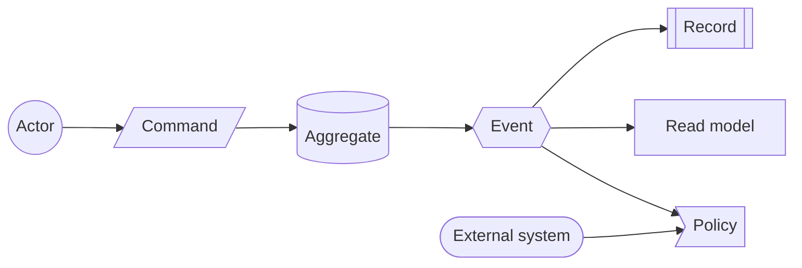
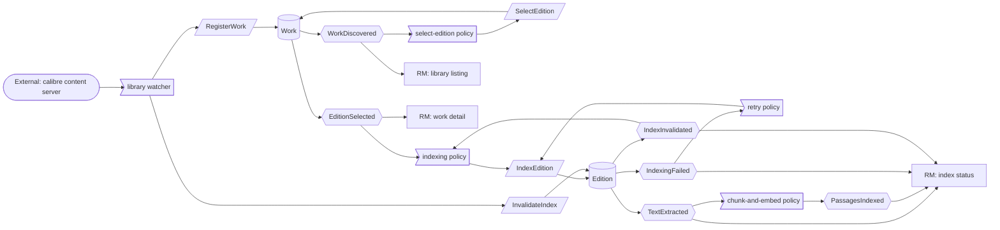
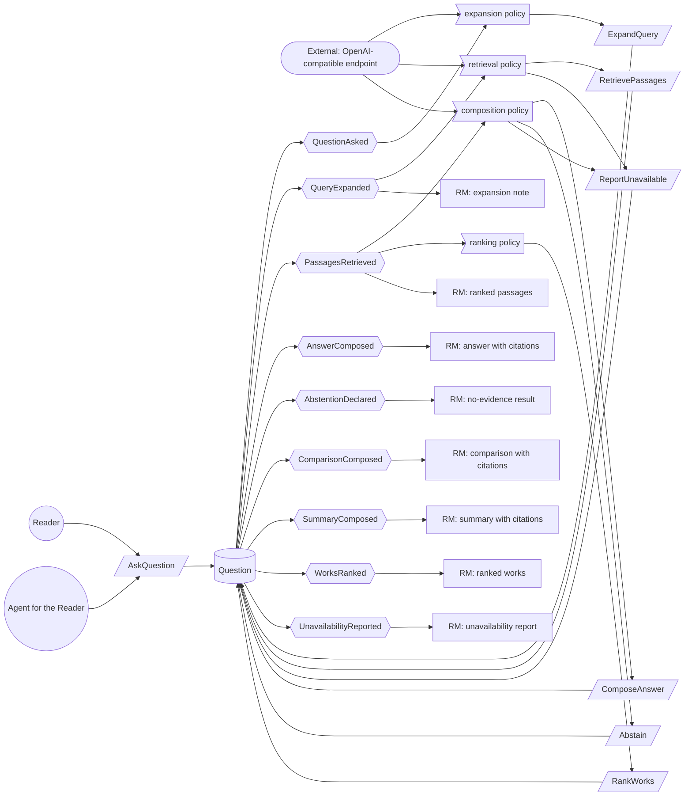
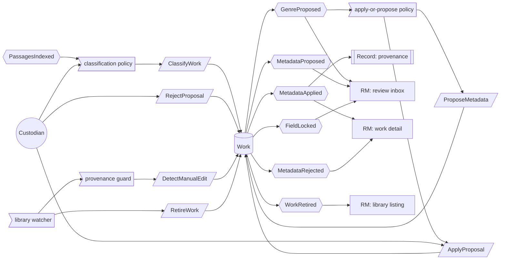
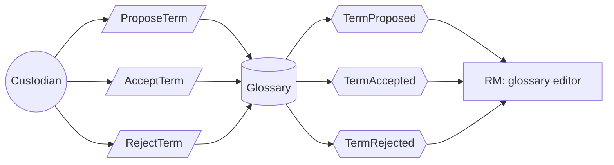

# Event Storming — evidence-search

Status: revised 2026-10-20 after the use-case cut review. Terms confirmed per
`domain-terms.md`. No statement is qualified by an open question.

## Actors

| Actor | Issues | Reads |
|---|---|---|
| Reader | asks questions | answers, passages |
| Agent for the Reader | asks questions and reads passages on the reader's behalf | answers, passages, index status |
| Custodian | confirms or rejects proposals, maintains the glossary | review inbox, work detail, glossary editor |

Not actors — policies: library watcher, select-edition policy, indexing policy,
retry policy, chunk-and-embed policy, expansion policy, retrieval policy,
ranking policy, composition policy, classification policy, apply-or-propose
policy, provenance guard.

## Aggregates

| Aggregate | Invariant | Commands | Events |
|---|---|---|---|
| Work | at most one edition is selected; at most one open proposal per field | RegisterWork, SelectEdition, ClassifyWork, ProposeMetadata, ApplyProposal, RejectProposal, DetectManualEdit, RetireWork | WorkDiscovered, EditionSelected, GenreProposed, MetadataProposed, MetadataApplied, MetadataRejected, FieldLocked, WorkRetired |
| Edition | exactly one index state; passages never cross a chapter boundary; an unchanged content hash is never re-embedded | IndexEdition, InvalidateIndex | TextExtracted, PassagesIndexed, IndexingFailed, IndexInvalidated |
| Question | exactly one response of the requested shape — answer, comparison, summary or works — one abstention with its reason, or one unavailability report, never more than one; every prose response sentence cites a retrieved passage of an indexed edition; no response below the evidence threshold; a works listing ranks only indexed works of the library | AskQuestion, ExpandQuery, RetrievePassages, ComposeAnswer, RankWorks, Abstain, ReportUnavailable | QuestionAsked, QueryExpanded, PassagesRetrieved, AnswerComposed, ComparisonComposed, SummaryComposed, WorksRanked, AbstentionDeclared, UnavailabilityReported |
| Glossary | at most one accepted term per concept and language; a proposed term has no effect until accepted | ProposeTerm, AcceptTerm, RejectTerm | TermProposed, TermAccepted, TermRejected |

Guards that live in policies, not in the aggregates:

- The format preference for the selected edition (EPUB > AZW3/MOBI > PDF) is a
  configuration of the select-edition policy. Retrieval joins the selected
  edition with its index state.
- The field-write guard belongs to the apply-or-propose policy: it reads the
  calibre field fresh and writes only if the field is empty or equals the
  provenance value; on a mismatch the field is locked. Every write is enqueued and retried on conflict, so a
  desktop change between read and write is detected rather than overwritten.

## External systems

The calibre content server (catalogue and file source), the OpenAI-compatible
endpoint (expansion, composition, embeddings), and the viewer that opens a
`calibre://` citation. None of them is an aggregate; the product calls
documented contracts only.

## Event chain

| # | Event | Issuer | Command | Aggregate | Reacting policy | Read model |
|---|---|---|---|---|---|---|
| 1 | WorkDiscovered | library watcher | RegisterWork | Work | select-edition policy | library listing |
| 2 | EditionSelected | select-edition policy | SelectEdition | Work | indexing policy | work detail |
| 3 | TextExtracted | indexing policy | IndexEdition | Edition | chunk-and-embed policy | index status |
| 4 | PassagesIndexed | indexing policy | IndexEdition | Edition | classification policy | index status |
| 5 | IndexingFailed | indexing policy | IndexEdition | Edition | retry policy | index status |
| 6 | IndexInvalidated | library watcher | InvalidateIndex | Edition | indexing policy | index status |
| 7 | WorkRetired | library watcher | RetireWork | Work | purge derived passages (projection maintenance) | library listing |
| 8 | QuestionAsked | Reader, Agent for the Reader | AskQuestion | Question | expansion policy | — |
| 9 | QueryExpanded | expansion policy | ExpandQuery | Question | retrieval policy | expansion note |
| 10 | PassagesRetrieved | retrieval policy | RetrievePassages | Question | composition policy, ranking policy | ranked passages |
| 11 | AnswerComposed | composition policy | ComposeAnswer | Question | — | answer with citations |
| 12 | ComparisonComposed | composition policy | ComposeAnswer | Question | — | comparison with citations |
| 13 | SummaryComposed | composition policy | ComposeAnswer | Question | — | summary with citations |
| 14 | WorksRanked | ranking policy | RankWorks | Question | — | ranked works |
| 15 | AbstentionDeclared | composition policy | Abstain | Question | — | no-evidence result |
| 16 | UnavailabilityReported | retrieval policy, composition policy | ReportUnavailable | Question | — | unavailability report |
| 17 | GenreProposed | classification policy | ClassifyWork | Work | apply-or-propose policy | review inbox |
| 18 | MetadataProposed | classification policy | ProposeMetadata | Work | — | review inbox |
| 19 | MetadataApplied | Custodian | ApplyProposal | Work | provenance guard | work detail |
| 20 | MetadataRejected | Custodian | RejectProposal | Work | — | work detail |
| 21 | FieldLocked | provenance guard | DetectManualEdit | Work | — | review inbox |
| 22 | TermProposed | Custodian | ProposeTerm | Glossary | — | glossary editor |
| 23 | TermAccepted | Custodian | AcceptTerm | Glossary | expansion policy | glossary editor |
| 24 | TermRejected | Custodian | RejectTerm | Glossary | — | glossary editor |

The four response shapes share one aggregate and one composition command; the
shape is decided at `AskQuestion`. `ComparisonComposed` and `SummaryComposed`
are answers in the confirmed term's sense — cited prose responses — with a
different shape.

## Reverse narrative

Which events must have happened for `AnswerComposed` to be possible?
`PassagesRetrieved` ← `QueryExpanded` ← `QuestionAsked`, and
`PassagesIndexed` ← `TextExtracted` ← `EditionSelected` ← `WorkDiscovered`.
`TermAccepted` is not a prerequisite: deterministic expansion uses accepted
terms where they exist, and the expansion policy may call the model endpoint
beyond them.

## Canvas

Kinds are distinguishable by shape: circle = actor, parallelogram = command,
cylinder = aggregate, hexagon = event, flag = policy, rectangle = read model,
subroutine = record, stadium = external system.

### Library intake and indexing

### Question answering

### Classification, metadata and retirement

### Glossary

## Read models

Library listing, work detail, index status, review inbox, glossary editor,
ranked passages, answer with citations, comparison with citations, summary with
citations, ranked works, no-evidence result, unavailability report, expansion
note.

## Open

None — every question is closed.
