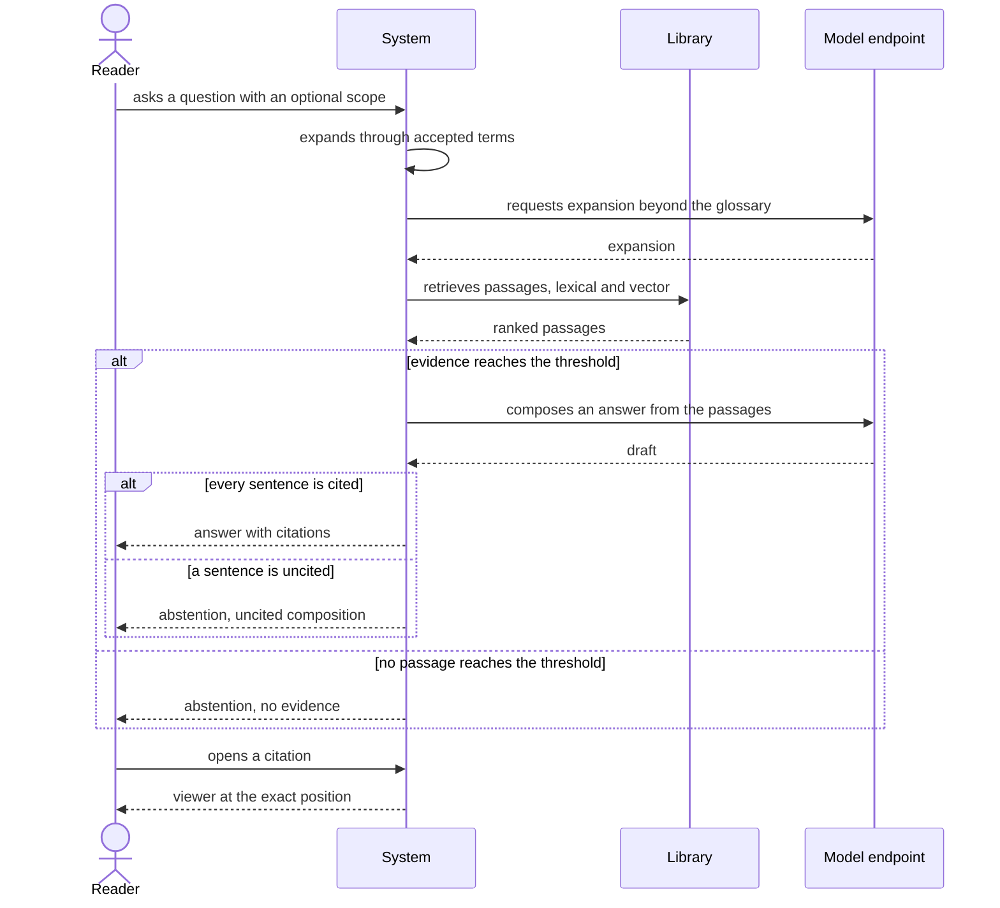

# Use case: answer-question

## Level

!

## Actors

- Reader (primary)
- Supporting: Agent for the Reader

## Goal

The reader holds a cited answer to a question about the library.

## Trigger

The reader asks a question in one language, optionally naming a scope.

## Preconditions

- The library is reachable through the content server.
- At least one edition is indexed.
- The question is asked in one language.

## Main flow

1. Reader asks a question in one language, optionally naming a scope (genre, language, authors, year range, works); System accepts the question together with its scope.
2. Reader waits; System expands the question through accepted glossary terms and, beyond them, through the configured expansion, and records the expansion used.
3. Reader waits; System retrieves passages on both retrieval paths, applies the scope to both, fuses and ranks the results.
4. Reader waits; System decides whether the retrieved evidence reaches the threshold.
5. Reader receives the answer together with the expansion used; System ensures every sentence carries at least one citation to a retrieved passage and that nothing outside the retrieval result is quoted.
6. Reader opens a citation; System opens the viewer at the exact position.
7. Reader finishes; System records the question, expansion, retrieved passages and answer for later inspection.

## Extensions

- 1a: The question names a work that is not in the library → System treats the scope as empty and abstains with reason `unknown work`; protects the guarantee that no evidence outside the library is returned.
- 2a: The glossary has no accepted term for the concept → System expands through the configured expansion only; protects the Success guarantee.
- 2b: The configured expansion is unavailable → System expands through accepted terms only; protects R1.
- 3a: The index is unavailable or older than the freshness bound → System reports unavailability and delivers no answer; protects the Minimal guarantee.
- 3b: The scope admits no passage above the threshold → System abstains with reason `scope`; protects R6.
- 3c: No passage reaches the threshold → System abstains with reason `no evidence`; protects R3.
- 3d: The configured composition is unavailable → System delivers no answer, returns the retrieved passages and reports unavailability with reason `composition unavailable`; protects the Minimal guarantee.
- 5a: The composed draft contains a sentence without a citation → System discards the draft and abstains with reason `uncited composition`; protects R1.

## Rules

- R1 Every sentence of an answer carries at least one citation to a passage of an indexed edition.
- R2 An answer quotes only passages from the retrieval result for that question.
- R3 No answer is delivered when no passage reaches the evidence threshold.
- R4 Every abstention carries exactly one reason from `no evidence`, `scope`, `unknown work`, `uncited composition`.
- R5 A question resolves to exactly one answer, exactly one abstention with a reason from R4, or exactly one unavailability report.
- R6 The scope filters apply to both retrieval paths before fusion.
- R7 The expansion used is returned with the answer.
- R8 The answer is written in the language of the question; quotations stay in their source language and keep their citation.
- R9 Answering never changes the library, its metadata or the glossary.
- R10 A question whose composition cannot run is reported as unavailable, with the retrieved passages and the reason `composition unavailable`; a draft that fails the citation rule is an abstention with reason `uncited composition`.

## Examples

- E1 — cross-language answer. Question: "Wie entsteht Vertrauen in Organisationen?" The library holds 12 matching works, one of them English. Retrieval returns four passages, two above the threshold. The answer has three sentences, each with a citation; one citation points into the English work, chapter "Trust in institutions", characters 4120–4380, and the viewer opens at that position. The English quotation stays in English. The returned expansion is "Vertrauen → trust, confidence".
- E2 — no evidence. Question: "Was sagt meine Bibliothek über Luhmanns Systemtheorie?" No work mentions Luhmann. Result: abstention, reason `no evidence`, no answer text.
- E3 — scope excludes. The same question with scope `genre=fachbuch`; the only relevant passage sits in a belletristik work. Result: abstention, reason `scope`.
- E4 — uncited draft. The composition returns four sentences, one without a citation. Result: no answer, abstention, reason `uncited composition`.
- E5 — composition unavailable. The configured composition is down after retrieval returned three passages. Result: no answer, an unavailability report with reason `composition unavailable`, the three passages are returned and `read_passage` still works.

## Minimal guarantee

- No answer is delivered unless every sentence is cited.
- On any failure the reader receives either an abstention with a reason from R4 or an unavailability report with its reason, carrying the retrieved passages when retrieval ran; never an invented answer.
- The library, its metadata and the glossary are unchanged.

## Success guarantee

The reader holds an answer whose every sentence carries at least one citation to a retrieved passage of an indexed edition.

## Personas

- reader--researcher — checks that the citation opens the exact position.
- agent--for-reader — checks that an abstention and an unavailability report are distinguishable.
- rights--holder — checks that no text leaves the host beyond the configured endpoint.

## Capabilities

- none

## Interactions

- none

## Includes

- none — uses the subfunctions retrieve-evidence, read-around-passage and resolve-citation.

## Extends

- none

## Out of scope

- find-passages — returning passages without prose.
- find-works — the ranked work list.
- compare-positions — the side-by-side over named works.
- summarize-work — the summary of one work.
- classify-works — assigning genres.
- review-metadata-proposals — deciding proposals.
- maintain-glossary — accepted terms.

## Diagram

