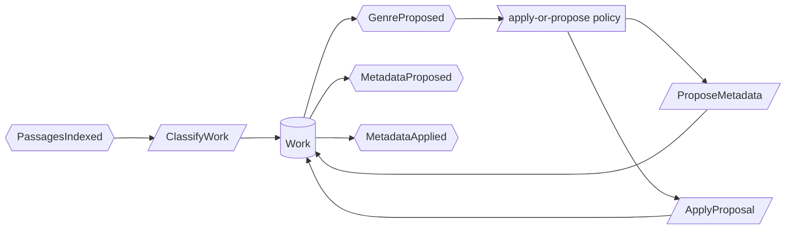

# Use case: classify-works

## Level

!

## Actors

- Custodian (primary)

## Goal

The custodian determines the genre of each indexed work, directly or by threshold rule.

## Trigger

A work becomes indexed, or the custodian starts a classification run.

## Preconditions

- The work is indexed.
- The genre value set is fixed: `fachbuch`, `sachbuch`, `belletristik`, `sonstiges`.

## Main flow

1. A work becomes indexed, or the custodian starts a classification run; System collects title, authors, existing tags, publisher, table of contents and three passages.
2. System proposes a genre with a confidence.
3. Custodian receives the result; System writes an empty field above the threshold and proposes otherwise.
4. Custodian confirms or corrects the genre; System records the decision as a proposal or an application.
5. On application, System enqueues the genre write; on success the queue records provenance.

## Extensions

- 2a: Confidence stays below the threshold → System proposes instead of writing; protects R2.
- 2b: The field already holds a value → System proposes; no autonomous write; protects R2.
- 3a: The calibre value differs from the provenance record → System refuses the write, locks the field and opens a review item; protects the guarantee against silent overwrite.
- 4a: The custodian rejects the proposal → the field stays unchanged; protects the Minimal guarantee.

## Rules

- R1 One genre per work, drawn from the fixed value set.
- R2 An empty field is written without a decision when the classification clears the configured confidence threshold; below it the result becomes a proposal.
- R3 Every write records provenance.
- R4 Classification touches no field other than genre.
- R5 A locked field is never written until the custodian resolves it.
- R6 The custodian sets the confidence threshold.
- R7 Every write is enqueued and retried on conflict.

## Examples

- E1 — a new German monograph, empty genre field, confidence high → `fachbuch` written and recorded in provenance.
- E2 — a novel with an existing manual genre `belletristik` → no write; the proposal appears in the review inbox.
- E3 — the custodian changed a genre by hand after the product wrote it → the field is locked and a review item appears.

## Minimal guarantee

- No genre is written that contradicts the custodian's decision.
- A manual change is never overwritten silently.
- A locked field stays unchanged.
- The library's other fields are untouched.

## Success guarantee

Every indexed work carries a genre determined by the custodian, written above the threshold or decided explicitly.

## Personas

- custodian--metadata — checks that a manual decision survives the next run.
- upstream--calibre — checks that only documented write contracts are used.

## Capabilities

- none

## Interactions

- none

## Includes

- none

## Extends

- none

## Out of scope

- review-metadata-proposals — deciding other metadata fields.
- maintain-glossary — accepting terms.
- answer-question, find-passages, find-works, compare-positions, summarize-work — the observing cases.

## Diagram

