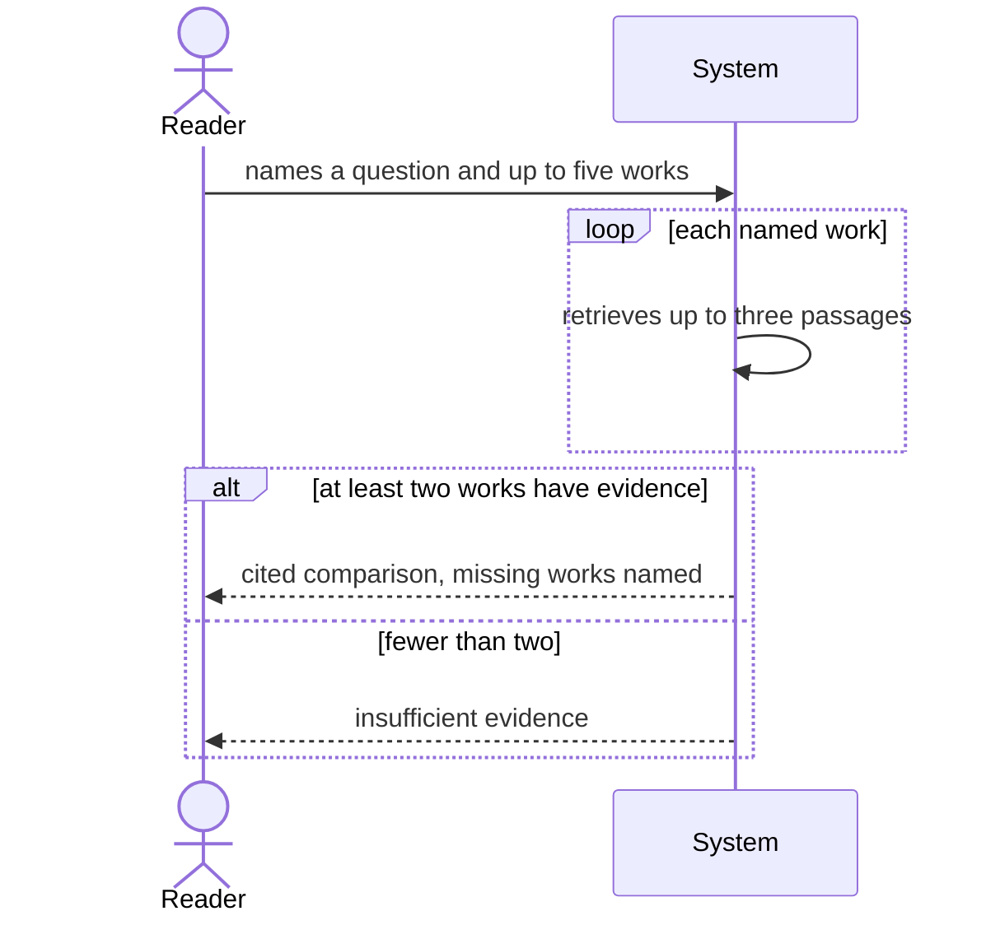

# Use case: compare-positions

## Level

!

## Actors

- Reader (primary)
- Supporting: Agent for the Reader

## Goal

The reader holds a cited comparison of how up to five named works treat one question.

## Trigger

The reader names a question and up to five works.

## Preconditions

- At least one of the named works is indexed.
- The question is expressed in one language.

## Main flow

1. Reader names a question and up to five works; System accepts the request and checks each work against the library.
2. Reader waits; System retrieves up to three passages per named work for the question.
3. Reader waits; System marks each work whose passages stay below the threshold as insufficient.
4. Reader receives a comparison in which every sentence cites at least one of the retrieved passages.
5. Reader opens a citation; System opens the viewer at the exact position.

## Extensions

- 1a: A named work is not in the library → System proceeds with the others and names the missing work; protects R5.
- 2a: Fewer than two works have sufficient evidence → System abstains with reason `insufficient evidence` and no comparison prose; protects R7.
- 2b: The model endpoint is unavailable for composition → System returns the retrieved passages and the reason `composition unavailable`; protects the Minimal guarantee.
- 4a: A composed sentence cannot be cited → System discards the draft and abstains with reason `uncited composition`; protects R4.

## Rules

- R1 Only the named works are compared.
- R2 At most five works per comparison.
- R3 At most three passages per work.
- R4 Every sentence that states a position cites a retrieved passage.
- R5 A work without sufficient evidence is named as such, never omitted; that note is a result field, not comparison prose.
- R6 No position is attributed to a work outside its retrieved passages.
- R7 Fewer than two works with sufficient evidence is an abstention with reason `insufficient evidence`.
- R8 The comparison is written in the language of the question; quotations stay in their source language.
- R9 The library is unchanged.

## Examples

- E1 — question "Wie entsteht Vertrauen?" with three works; two have evidence, the third is marked insufficient; every sentence carries a citation.
- E2 — two works, neither above the threshold → abstention with reason `insufficient evidence`, no prose.
- E3 — four works, one missing from the library → the comparison covers three and names the missing one.

## Minimal guarantee

- No work is attributed a position its passages do not carry.
- A failure is reported as an abstention or an unavailability report, never as a plausible comparison.
- The library is unchanged.

## Success guarantee

The reader holds a comparison whose every sentence cites a retrieved passage of a named work.

## Personas

- reader--researcher — checks that each work's position is traceable.
- agent--for-reader — checks that `insufficient evidence` is distinguishable from a comparison.
- rights--holder — checks that no text leaves the host beyond the configured endpoint.

## Capabilities

- none

## Interactions

- none

## Includes

- none — uses the subfunctions retrieve-evidence, read-around-passage and resolve-citation.

## Extends

- none

## Out of scope

- answer-question — answering without named works.
- find-works — choosing the works.
- summarize-work — summarizing one work.
- find-passages — raw passages without comparison.
- classify-works, review-metadata-proposals, maintain-glossary — the changing cases.

## Diagram

