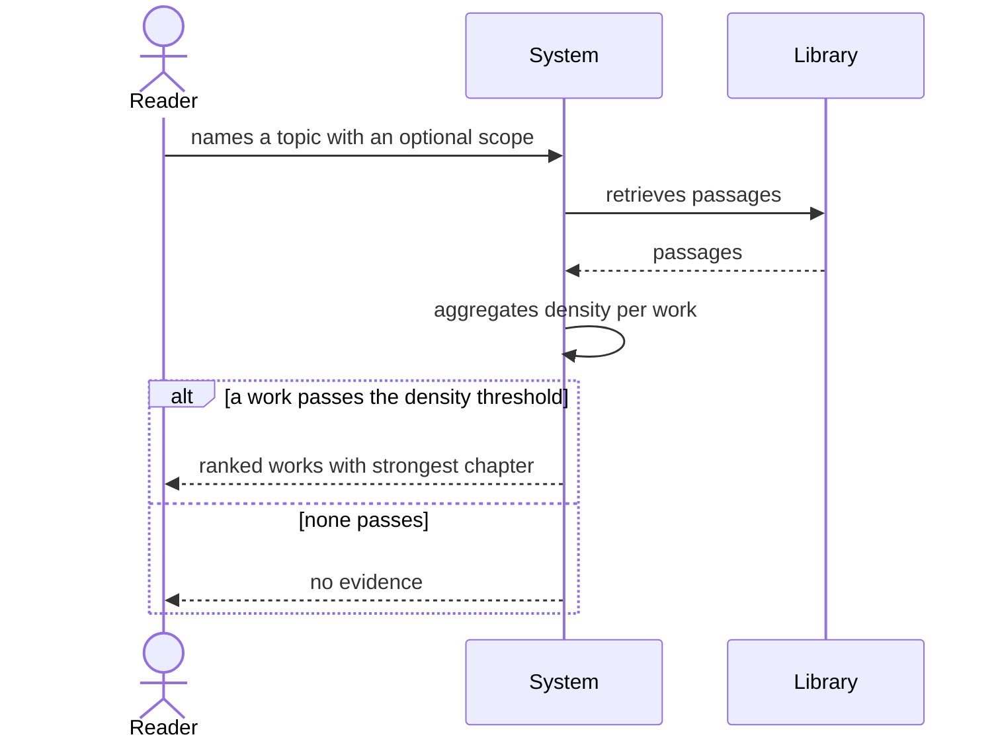

# Use case: find-works

## Level

!

## Actors

- Reader (primary)
- Supporting: Agent for the Reader

## Goal

The reader holds a ranked list of the works that treat a topic.

## Trigger

The reader names a topic, optionally with a scope.

## Preconditions

- The library is reachable through the content server.
- At least one edition is indexed.

## Main flow

1. Reader names a topic in one language with an optional scope; System accepts the request.
2. Reader waits; System expands the topic through accepted glossary terms and, beyond them, through the configured expansion.
3. Reader waits; System retrieves passages, aggregates their density per work, and ranks the works.
4. Reader receives the ranked works, each with its strongest chapter and the passage count that carried it.
5. Reader may open a work or ask for its passages; System hands over to find-passages or the viewer.

## Extensions

- 3a: No work reaches the density threshold → System returns `no evidence` with reason `no evidence`; protects R5.
- 3b: The index is unavailable → System returns an unavailability report; protects the distinction from an empty success.

## Rules

- R1 Only indexed works of the library appear.
- R2 Ranking is by passage density for the topic, never by metadata alone.
- R3 Each listed work names the chapter with the highest density.
- R4 The list contains no prose answer and no quotation.
- R5 `no evidence` is a result, never an empty success.
- R6 The order is deterministic: density, then work id.

## Examples

- E1 — "Vertrauen in Organisationen" lists seven works; the first is an English monograph, strongest chapter "Trust in institutions", six passages.
- E2 — a topic absent from the library → `no evidence`, no list.

## Minimal guarantee

- No work is listed that is not in the library.
- A failure is reported as a failure, never as an empty list.
- The library is unchanged.

## Success guarantee

The reader holds a ranked list of works, each naming its strongest chapter.

## Personas

- reader--researcher — checks that the top work is worth opening.
- agent--for-reader — checks that the ranked works lead to retrievable passages.

## Capabilities

- none

## Interactions

- none

## Includes

- none — uses the subfunction retrieve-evidence.

## Extends

- none

## Out of scope

- answer-question — composing prose.
- find-passages — the passages themselves.
- compare-positions — comparing named works.
- summarize-work — summarizing a work.
- classify-works, review-metadata-proposals, maintain-glossary — the changing cases.

## Diagram

