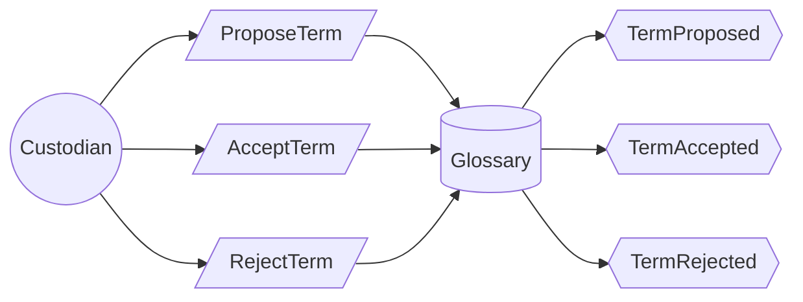

# Use case: maintain-glossary

## Level

!

## Actors

- Custodian (primary)

## Goal

The custodian keeps one accepted term per concept and language.

## Trigger

The custodian proposes a term.

## Preconditions

- The glossary exists.

## Main flow

1. Custodian proposes a concept with its terms per language; System records the proposal.
2. Custodian inspects the proposal; System shows conflicts with accepted concepts and terms.
3. Custodian accepts or rejects; System records the decision.
4. System makes accepted terms available to the expansion policy and keeps rejected terms with their reason.

## Extensions

- 1a: A proposed term is already accepted for another concept in the same language → System marks the proposal as ambiguous; protects R6.
- 2a: The same term is proposed for the same concept and language → System treats the proposal as already accepted; protects R1.

## Rules

- R1 At most one accepted term per concept and language.
- R2 A proposed term has no effect on expansion until accepted.
- R3 Only accepted terms expand a question deterministically.
- R4 A rejected term stays recorded with its reason.
- R5 A term and its concept are stored in the domain vocabulary, not in calibre tags.
- R6 No accepted term belongs to more than one concept in the same language.

## Examples

- E1 — concept "trust" with `de: Vertrauen`, `en: trust` accepted; expansion now maps the German question to the English term.
- E2 — "Vertrauen" proposed again for the same concept → already accepted, nothing changes.
- E3 — "confidence" proposed as a second English term for "trust" → rejected by R1, recorded with the reason.
- E4 — "trust" proposed for a second concept in English → marked ambiguous by R6, not accepted.

## Minimal guarantee

- No proposed term changes an expansion result before acceptance.
- A rejected term is not lost; it is recorded with its reason.
- The library and its metadata are unchanged.

## Success guarantee

Each concept has at most one accepted term per language, and accepted terms are available to expansion.

## Personas

- custodian--glossary — checks that the vocabulary stays small enough to trust.
- agent--for-reader — checks that accepted terms actually change the expansion.
- reader--researcher — checks that the German question finds the English passage.

## Capabilities

- none

## Interactions

- none

## Includes

- none

## Extends

- none

## Out of scope

- classify-works — assigning genres.
- review-metadata-proposals — deciding metadata proposals.
- answer-question, find-passages, find-works, compare-positions, summarize-work — the observing cases.

## Diagram

