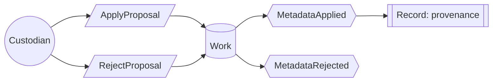

# Use case: review-metadata-proposals

## Level

!

## Actors

- Custodian (primary)

## Goal

The custodian decides a pending metadata proposal.

## Trigger

The custodian opens a pending proposal.

## Preconditions

- At least one proposal is open.
- The calibre content server is reachable.

## Main flow

1. Custodian opens a pending proposal; System shows the field, the current value, the proposed value and the rationale.
2. Custodian inspects the difference and its evidence; System shows both.
3. Custodian decides to apply or reject.
4. On apply, System enqueues the write; the queue re-reads the field, compares it with the provenance record, writes the value and records the new provenance.
5. On reject, System records the rejection and leaves the field unchanged.

## Extensions

- 3a: The custodian leaves without deciding → the proposal stays pending; protects R2.
- 4a: The current calibre value differs from the value the proposal was based on → System refuses the write, reports a conflict and re-bases the proposal; protects the guarantee against silent overwrite.
- 4b: The content server is unreachable → the write is queued and retried while the decision stands; protects the guarantee that a failed write leaves the field as it was.
- 4c: The field is locked by a manual edit → System shows the manual value as authoritative; applying the proposal requires the custodian to overwrite it explicitly; protects the guarantee against silent overwrite.

## Rules

- R1 At most one open proposal per field.
- R2 A write happens only on the custodian's decision.
- R3 A rejection leaves the value unchanged.
- R4 A conflict never overwrites; the proposal is re-based on the current value.
- R5 Every applied write records provenance.
- R6 A proposal concerns exactly one work and one field.
- R7 Every write is enqueued and retried on conflict; the queue survives a restart.

## Examples

- E1 — proposal `tags: genre.fachbuch` on a work whose tag field is empty → apply writes `genre.fachbuch` and records it.
- E2 — the custodian changed the tag to `genre.sachbuch` after the proposal was made → apply reports a conflict, nothing is written, the proposal is re-based.
- E3 — reject → the tag stays as it was; the rejection is recorded.

## Minimal guarantee

- No value is written without the custodian's decision.
- A manual change is never overwritten silently.
- A failed write leaves the field as it was.

## Success guarantee

The work reflects the custodian's decision on the proposal: the applied value, or the unchanged value on rejection.

## Personas

- custodian--metadata — checks that the inbox stays small and that no decision is lost.
- upstream--calibre — checks that the write path uses documented contracts only.

## Capabilities

- none

## Interactions

- none

## Includes

- none

## Extends

- none — resolves a locked field (`FieldLocked`) in 4c.

## Out of scope

- classify-works — proposing the genre.
- maintain-glossary — accepting terms.
- answer-question, find-passages, find-works, compare-positions, summarize-work — the observing cases.

## Diagram

