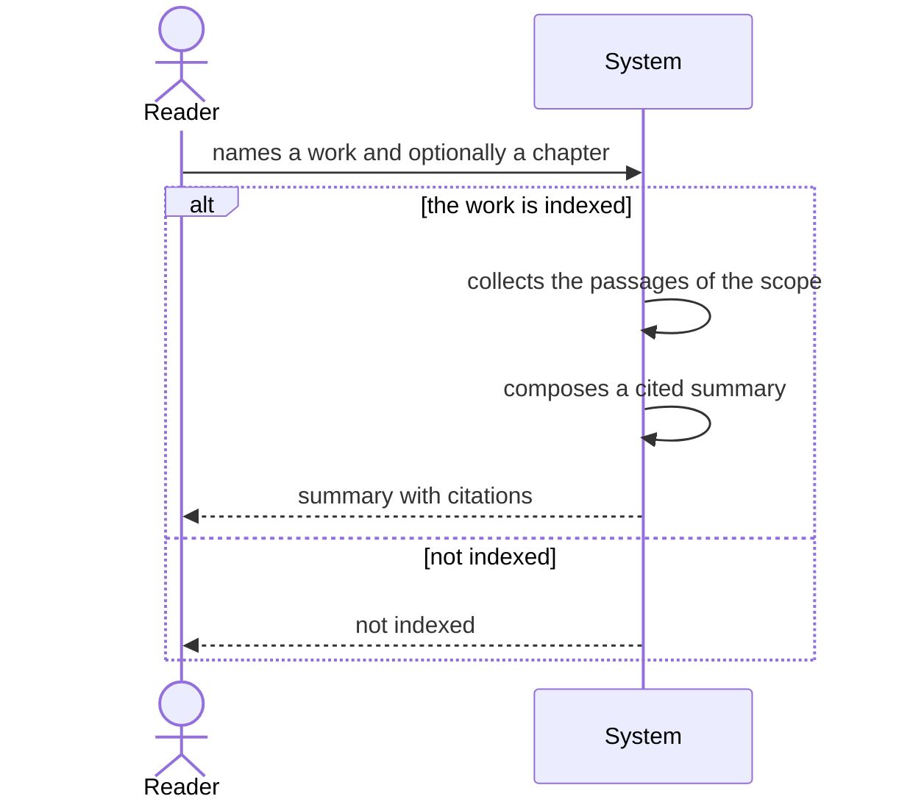

# Use case: summarize-work

## Level

!

## Actors

- Reader (primary)
- Supporting: Agent for the Reader

## Goal

The reader holds a cited summary of one work or one chapter.

## Trigger

The reader names a work and, optionally, a chapter.

## Preconditions

- The named work is in the library.

## Main flow

1. Reader names a work and optionally a chapter; System accepts the request and resolves the scope.
2. Reader waits; System collects the passages of the scope.
3. Reader waits; System composes a summary in which every sentence cites at least one collected passage.
4. Reader receives the summary and its evidence list.
5. Reader opens a citation; System opens the viewer at the exact position.

## Extensions

- 1a: The work is not indexed → System refuses with reason `not indexed`; protects the Minimal guarantee.
- 1b: The chapter does not exist → System refuses with reason `unknown chapter`; protects the Minimal guarantee.
- 3a: The model endpoint is unavailable → System returns the collected passages and the reason `composition unavailable`; protects the Minimal guarantee.
- 3b: A composed sentence cannot be cited → System discards the draft and refuses with reason `uncited composition`; protects R1.

## Rules

- R1 Every sentence of the summary cites a collected passage of the named work.
- R2 The summary uses only text from the named work and, when given, only the named chapter.
- R3 A work with no indexed text is never summarized.
- R4 The summary is written in the language of the request; quotations stay in their source language.
- R5 The library is unchanged.

## Examples

- E1 — a chapter summary of six sentences, each with a citation; the evidence list holds eleven passages.
- E2 — a work that was never indexed → refusal `not indexed`.
- E3 — a chapter name absent from the table of contents → refusal `unknown chapter`.

## Minimal guarantee

- No sentence is delivered without a collected passage behind it.
- A refusal always carries its reason; no partial summary is passed off as complete.
- The library is unchanged.

## Success guarantee

The reader holds a summary whose every sentence cites a passage of the named work.

## Personas

- reader--researcher — checks that the summary does not overreach the work.
- agent--for-reader — checks that the refusal reasons are distinguishable.
- rights--holder — checks that no text leaves the host beyond the configured endpoint.

## Capabilities

- none

## Interactions

- none

## Includes

- none — uses the subfunctions retrieve-evidence and resolve-citation.

## Extends

- none

## Out of scope

- answer-question — answering a question.
- compare-positions — comparing works.
- find-works — listing works.
- find-passages — raw passages without summary.
- classify-works, review-metadata-proposals, maintain-glossary — the changing cases.

## Diagram

