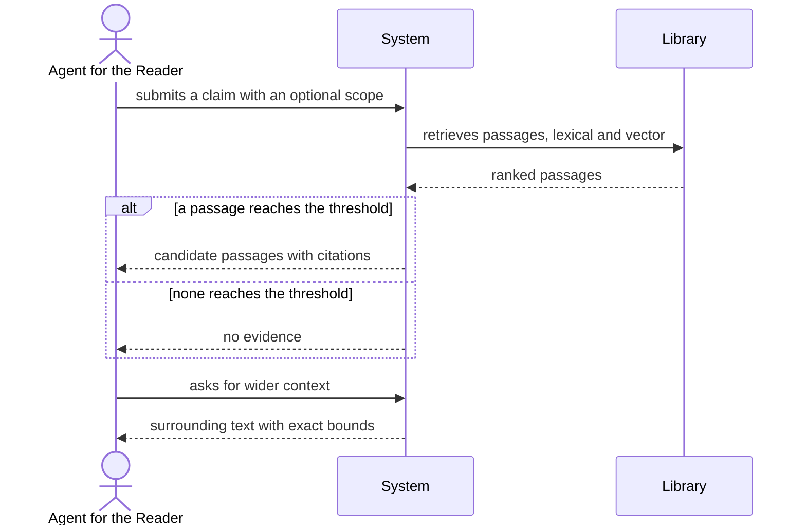

# Use case: find-passages

## Level

!

## Actors

- Agent for the Reader (primary)
- Supporting: Reader

## Goal

The agent holds candidate passages for a claim, each with a citation.

## Trigger

The agent submits a claim or a search phrase, optionally with a scope.

## Preconditions

- The request is expressed in one language.
- The normal case is a reachable library with at least one indexed edition;
  extension 3b covers an unavailable or stale index and extension 3c covers an
  unreachable library.

## Main flow

1. Agent submits a claim or phrase in one language with an optional scope (genre, language, authors, year range, works); System accepts the request.
2. Agent waits; System expands the request through accepted glossary terms and, beyond them, through the configured expansion.
3. Agent waits; System retrieves on both retrieval paths, applies the scope to both, fuses and ranks.
4. Agent receives up to the requested number of candidate passages, each with a citation, a score and the expansion used.
5. Agent requests wider context around a passage; System returns the surrounding text with exact bounds.

## Extensions

- 1a: The scope names a work that is not in the library → System returns `no evidence` with reason `unknown work`; protects the guarantee that no passage outside the library is returned.
- 3a: No passage reaches the threshold → System returns `no evidence` with reason `no evidence`; protects R6.
- 3b: The index is unavailable or older than the freshness bound → System returns an unavailability report with the reason `index unavailable` or `stale index`; protects the distinction from an empty success.
- 3c: The library cannot be reached → System returns an unavailability report with the reason `library unreachable`; protects the distinction between "the library does not support the question" and "the library could not be checked".
- 4a: Fewer passages than requested exist above the threshold → System returns what exists and marks the result as short; never pads; protects R4.

## Rules

- R1 Every returned passage carries a citation to an indexed edition.
- R2 The result contains only passages retrieved for this request.
- R3 The order is deterministic: score, then work id in numeric order, then passage index.
- R4 The result is capped at the requested number, at most 20.
- R5 The product does not judge whether a passage supports the claim.
- R6 `no evidence` is a result, never a failure and never an empty success.
- R7 The scope filters apply to both retrieval paths before fusion.

## Result shapes

The request in this use case is a `Question`. Its exactly-one outcome is refined
here to include the retrieval result: a `Question` resolves to exactly one
candidate-passage result, one abstention with its reason, or one unavailability
report. The three are mutually exclusive and are distinguishable by the
consumer; a candidate-passage result also carries whether it is short of the
requested number. An unavailability report is not an abstention: it says the
system cannot answer, not that the library does not support the question. An
abstention may name the editions that failed indexing and their reasons, so a
missing passage is distinguishable from a missing capability.

## Examples

- E1 — five passages for "Vertrauen in Organisationen" with scope `genre=fachbuch`; three come from one English work, each with its own citation.
- E2 — a claim about a topic absent from the library → `no evidence`, reason `no evidence`.
- E3 — the agent requests 20 passages, four reach the threshold → four returned, `short: true`, no padding.

## Minimal guarantee

- No passage is returned that does not exist at its citation.
- A failure is reported as a failure, never as an empty success.
- The library, its metadata and the glossary are unchanged.

## Success guarantee

The agent holds candidate passages for the claim, each with a citation, in a deterministic order, and can widen the context around any of them with exact bounds.

## Personas

- agent--for-reader — checks that `no evidence` is distinguishable from failure and that order is deterministic.
- reader--researcher — checks that a citation carries the exact position as the character span the agent opens; the position-aware viewer opening is deferred (TD-009).

## Capabilities

- `passage-retrieval` — NEW in this use case.

## Interactions

| Capability | Consumer action | E2E scenario |
|---|---|---|
| passage-retrieval | submit a claim or phrase with an optional scope | Agent retrieves cited passages for a claim |
| passage-retrieval | request wider context around a cited passage | Agent widens context around a cited passage |

## Includes

- none.

## Extends

- none.

## Out of scope

- answer-question — composing prose.
- find-works — ranking works.
- compare-positions — comparing named works.
- summarize-work — summarizing a work.
- classify-works, review-metadata-proposals, maintain-glossary — the changing cases.

## Diagram

